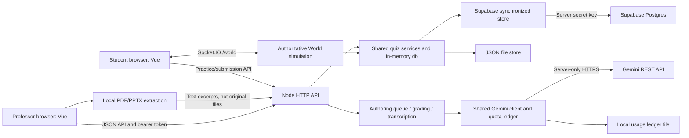
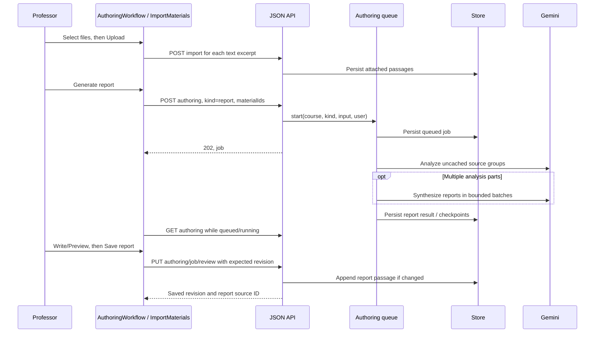
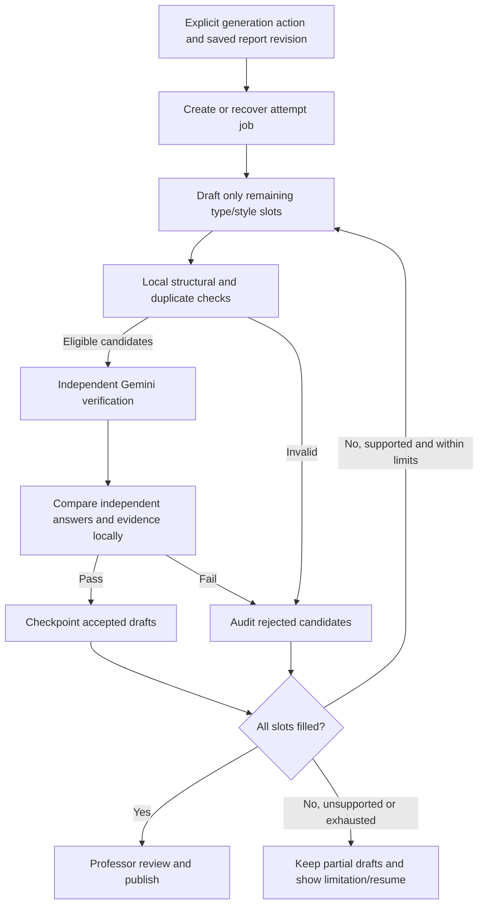
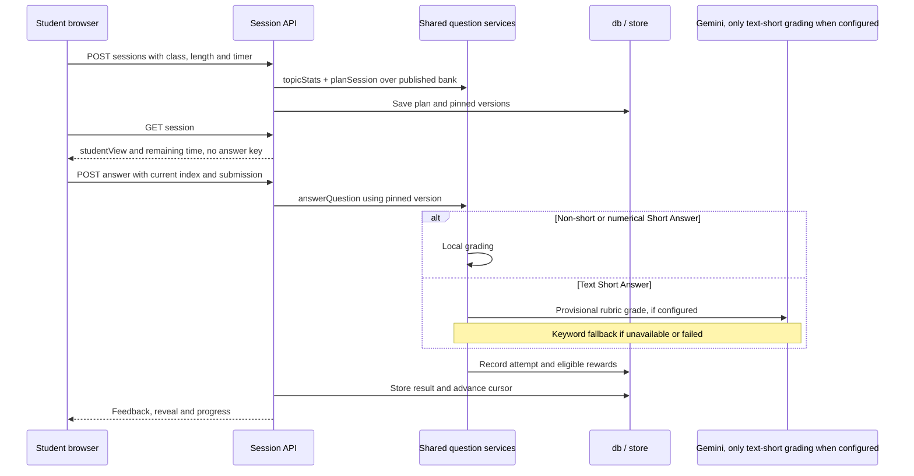

# QuizQuest Codebase Guide

Source review date: **16 October 2026**. This guide describes the implementation in this working tree, including prototype and legacy behavior. It does not establish the state of a deployed application, a live database, or a Gemini account. No secret environment values are included.

## Table of contents

1. [Purpose and implementation status](#1-purpose-and-implementation-status)
2. [Technology, architecture, and entry points](#2-technology-architecture-and-entry-points)
3. [Repository map](#3-repository-map)
4. [Frontend organization and shared state](#4-frontend-organization-and-shared-state)
5. [Backend organization and API conventions](#5-backend-organization-and-api-conventions)
6. [Data model and persistence](#6-data-model-and-persistence)
7. [Authentication, courses, and classes](#7-authentication-courses-and-classes)
8. [Lecture upload, extraction, and file management](#8-lecture-upload-extraction-and-file-management)
9. [Knowledge report generation, editing, and versioning](#9-knowledge-report-generation-editing-and-versioning)
10. [AI question drafting and independent verification](#10-ai-question-drafting-and-independent-verification)
11. [Review, manual editing, publishing, and Question Bank](#11-review-manual-editing-publishing-and-question-bank)
12. [Student practice, realtime gameplay, and grading](#12-student-practice-realtime-gameplay-and-grading)
13. [Analytics, rewards, and supporting features](#13-analytics-rewards-and-supporting-features)
14. [API reference by workflow](#14-api-reference-by-workflow)
15. [Important functions and call relationships](#15-important-functions-and-call-relationships)
16. [Configuration, Gemini requests, retries, and quotas](#16-configuration-gemini-requests-retries-and-quotas)
17. [Errors, recovery, and security boundaries](#17-errors-recovery-and-security-boundaries)
18. [Legacy paths, incomplete features, and known limitations](#18-legacy-paths-incomplete-features-and-known-limitations)
19. [Tests and documentation verification](#19-tests-and-documentation-verification)

## 1. Purpose and implementation status

QuizQuest is a formative learning prototype. Professors prepare source material, create and review questions, and publish a course question bank. Students practise from that bank, receive feedback, and earn coins and resources used in a multiplayer World, pets/shop, and kingdom-building features.

The main AI authoring flow is implemented:

**Upload material → generate a Markdown knowledge report → edit and explicitly save the report → configure questions → draft and independently verify → review/edit → publish.**

Manual authoring works without Gemini and without a report. New authoring exposes four formats: MCQ, True/False, Short Answer, and Multi-select. Existing numeric and parameterized mathematics questions remain supported by historical editing and grading code.

This is still a prototype: demo identity selection, whole-database in-memory operation, and single-server assumptions are part of the current design. The Supabase adapter is implemented, but Supabase Auth, browser database access, and original-file Storage uploads are not.

## 2. Technology, architecture, and entry points

The authoritative dependency list and scripts are in [package.json](../package.json).

| Layer | Current implementation |
| --- | --- |
| Runtime | Node.js, minimum declared version `22.13.0`; CommonJS backend modules |
| Frontend | Vue 3 single-file components, JavaScript, shared CSS; Vite build/dev server |
| HTTP | Node `http`, with a custom JSON API router; no Express dependency |
| Browser HTTP client | Axios |
| Realtime | Socket.IO server and browser client |
| Persistence | JSON file or Supabase Postgres through `@supabase/supabase-js`; in-memory option for tests |
| AI | Server-side Gemini REST requests through the shared `generateJson()` client |
| Documents | Browser PDF.js worker; browser PPTX ZIP/XML extraction with `fflate` and `DOMParser` |
| Verification tools | Node test runner, Playwright, local PGlite database tests, Vite build, syntax script |



The persistence branches are alternatives chosen at startup, not simultaneous replicas. The Gemini usage ledger remains a local file even in Supabase mode.

Entry points:

- [server.js](../server.js), `start(port, opts)`: constructs the quiz API, HTTP server, legacy Circle Tag game, and `/world` namespace. Returns `{ io, httpServer, quiz, world }`; tests use port `0` and isolated stores.
- Direct execution of `server.js`: connects the Supabase store when `SUPABASE_URL` is set; otherwise uses `QUIZ_DATA_FILE` or `data/db.json`.
- [web/src/main.js](../web/src/main.js): mounts `App.vue` on `#app`.
- [web/src/App.vue](../web/src/App.vue): restores the session and chooses role-specific views.
- [scripts/dev.js](../scripts/dev.js): starts the API, waits for `/api/demo-users`, selects a free API port when needed, then starts Vite. Both are direct children so shutdown does not leave a nested Node watcher behind.
- [vite.config.mjs](../vite.config.mjs): builds `web/` into `dist/`; development uses port `5173` or Vite's next available port and proxies API, Socket.IO, Circle Tag, and Hero Lab requests to Node.

Production-style startup serves the built frontend from Node, normally on port `3000`. `/tag` serves the original Circle Tag experiment; `/hero-lab` serves a separate static prototype. Neither is the main Vue professor authoring screen.

## 3. Repository map

```text
server.js                     HTTP/static serving, Circle Tag, World attachment, startup
web/
  index.html                  Vue HTML entry
  src/
    App.vue, main.js          App shell and mount
    api.js, ui.js, app.css    Shared client state, HTTP, notifications, styling
    components/               Fields, async buttons, Markdown editing/rendering, paging
    teacher/                  Authoring, source material, Question Bank, analytics/settings
    student/                  Practice, question inputs/results, World, pets, kingdom
src/
  quiz/                       Domain logic, JSON API, authoring, Gemini, grading, economy
  db/                         Supabase adapter and object/table serialization
  world/                      Multiplayer World server
supabase/migrations/          Supplied Postgres schema and RLS setup
public/                       Circle Tag and Hero Lab static assets
scripts/                      Dev/check/reset tools and explicit live diagnostic tools
test/                         Unit, API, local database, Socket.IO and browser tests
docs/                         This guide and other design/incident documents
data/                         Runtime JSON database / Gemini usage ledger when configured
dist/                         Generated Vite build
```

Existing proposal/design documents can supply background, but source behavior takes precedence over their feature descriptions. Runtime data and generated artifacts are not application source.

## 4. Frontend organization and shared state

[web/src/api.js](../web/src/api.js) exports reactive `S`, `api()`, session helpers, and navigation helpers. `S` holds the active user, token, selected course/class, current tab, filters, and a `viewKey`. This app uses component/tab state rather than Vue Router. `rerender()` changes the key to remount the current view after a mutation.

Axios attaches the bearer token. Responses for a token that is no longer active are rejected, preventing a slow response for one professor from replacing another professor's data. Authentication expiry clears the client session. The token is kept in `sessionStorage` when available.

[teacher/courses.js](../web/src/teacher/courses.js) caches course metadata per token. `loadCourses(true)` forces a reload, which matters after authoring creates new topic/outcome records. `CoursePicker.vue` and teacher/student class pickers coordinate selection with `S`.

| Component | Responsibility |
| --- | --- |
| [GenerateView.vue](../web/src/teacher/GenerateView.vue) | Loads the course; selects the saved-report workflow when authoring is enabled, otherwise the direct drafting UI (which reports that Gemini is unavailable) |
| [AuthoringWorkflow.vue](../web/src/teacher/AuthoringWorkflow.vue) | Report selection, explicit save, assessment settings, generation attempts, progress/recovery, navigation to review |
| [ImportMaterials.vue](../web/src/teacher/ImportMaterials.vue) | Multi-file selection/extraction, selected/uploaded status, partial retries, remove/replace, server attachment synchronization |
| [MaterialLibrary.vue](../web/src/teacher/MaterialLibrary.vue) | Material library (folded into the AI drafting tab): pasted text, PDF extraction and explicit scan/diagram transcription |
| [ReviewView.vue](../web/src/teacher/ReviewView.vue) | Question Bank filters, fetching questions/passages, opening new editors and focusing a requested question |
| [QuestionCard.vue](../web/src/teacher/QuestionCard.vue) | Question metadata and lifecycle actions; embeds the editor |
| [QuestionDetails.vue](../web/src/teacher/QuestionDetails.vue) | Shared professor answer/options, model answer, rubric and explanation presentation |
| [QuestionEditor.vue](../web/src/teacher/QuestionEditor.vue) | Manual/new/edit form, type-specific answers, validation, save/version behavior and tab-local recovery |
| [MarkdownEditor.vue](../web/src/components/MarkdownEditor.vue) | Shared Write/Preview text control used for reports, question stems and explanations |
| [RichText.vue](../web/src/components/RichText.vue), [rich-text.mjs](../web/src/components/rich-text.mjs) | Safe Markdown subset rendered through Vue text nodes; no raw HTML execution |
| [AnalyticsView.vue](../web/src/teacher/AnalyticsView.vue), [EvaluationView.vue](../web/src/teacher/EvaluationView.vue), [SettingsView.vue](../web/src/teacher/SettingsView.vue) | Class/course analysis, evaluation summaries, marking and configuration |

`MarkdownPreview.vue` also wraps the shared renderer, although the main report editor now uses `MarkdownEditor.vue` directly. The renderer handles fenced and indented code, inline code, basic lists/headings/emphasis, and line breaks. Common/numeric HTML entities are normalized for display, without rewriting stored answers. Math notation is preserved as text; this is not a full mathematical typesetting engine.

`authoring-draft.js` exposes `draftStore(key, value)`, using IndexedDB database `quizquest-authoring`, object store `drafts`. It stores extracted excerpts, report editor/configuration recovery, and pending generation requests. Question editing uses separate `sessionStorage` records keyed by user, course, question, and version. These browser copies support recovery; they are not substitutes for an explicit server save.

## 5. Backend organization and API conventions

[src/quiz/api.js](../src/quiz/api.js) is the HTTP/domain integration point. `createQuizApi()` receives an optional store, clock, and mock drafter/providers; it returns `{ handle, db, store, services, GEN }`.

Its private route registry matches HTTP methods and parameterized paths. `handle(req, res)` parses JSON, authenticates, checks the required role, calls the handler, and serializes the response. Domain access helpers such as `teacherCourse()`, `teacherQuestion()` and `studentSession()` check ownership/assignment, not just whether the caller is a teacher or student. Unauthorized object lookups generally return `404` to avoid revealing another class's IDs.

Handlers return a JSON value or `[status, body]`; CSV/download handlers use a raw-response shape. Expected errors use `HttpError`; `authoringReply()` translates the queue's status-bearing errors. Unexpected errors are logged server-side and sent as generic `500` responses without stacks. Default JSON body size is 100 KiB, with larger explicit limits for text imports, report saves, and image transcription.

`save()` updates a data-version counter and schedules persistence. `persist()` additionally awaits `store.flush()` and checks `store.pending()`. Authoring uses this stronger checkpoint before inference and when saving progress; ordinary routes often use scheduled `save()` instead.

The `services` object gives the World access to authentication, enrollment, question selection, shared grading, rewards, resources, and balances. The World does not implement a separate question-grading system.

## 6. Data model and persistence

All domain modules operate on one in-memory `db` object. [seed.js](../src/quiz/seed.js), `seed()`, creates synthetic users, courses, classes, questions and history. Its current schema marker is `SCHEMA = 2`.

| Domain objects | Meaning and relationships |
| --- | --- |
| `users`, `courses`, `classes`, `enrolments` | Synthetic identities; teacher assignments; class-to-course relationship; student membership |
| `topics[].outcomes` | Weekly course topics (optional `week` 1–52, kept in `extra` in Supabase) with nested learning outcomes, referenced by questions, source passages and reports. Shared by every class of the course; [topics.js](../src/quiz/topics.js) sorts by week and builds the per-topic summary |
| `passages` | Extracted/pasted material and immutable saved report revisions; includes provenance and attachment metadata |
| `courses[].authoringJobs` | Durable authoring jobs, configuration, progress, model metrics, recovery and validation audit data |
| `courses[].analysisCache` | Reusable source-group analysis results |
| `generationLog` | Generator-level records: inputs, calls, retrieved passages, created question IDs, rejected candidates |
| `questions[].versions` | Question text, format-specific answer data, sources, explanation and publication/edit timestamps |
| `questions[].reports` | Student issue reports and resolution state |
| `sessions` | Practice plans with pinned question versions, cursor, timing, stored results, NPC and completion rewards |
| `attempts` | Submission, version, score/correctness, timing, practice/World context and marking state |
| `ledger`, `inventory`, `kingdoms`, `trades`, `resourceLog`, `participation` | Coin/resource accounting, collections, building and class participation features |

### JSON store

[store.js](../src/quiz/store.js), `createStore(file)`, loads JSON or seeds a database. `file = null` makes it memory-only. `save()` batches writes with a 250 ms delay; `flush()` writes a temporary file and renames it. Old schema-marked files are backed up and replaced with fresh demo data, rather than migrated in place. Do not treat that behavior as a production migration strategy.

### Supabase store

[supabase-store.js](../src/db/supabase-store.js), `connectSupabaseStore()`, builds a server-only Supabase client and calls `createSyncedStore()`. Startup loads the database tables into memory. Later flushes calculate row differences and upsert changed rows or delete removed rows. Reads are paged in groups of 1,000; upserts use batches of 500. Parents are written before children, and deletes run in reverse order.

[schema.js](../src/db/schema.js), `toTables()` and `fromTables()`, maps camelCase fields to SQL columns, converts timestamps, and splits nested outcomes, question versions and reports into child tables. Unmapped fields go into each row's `extra` JSONB column. Consequently, authoring jobs/cache and newer question metadata persist without dedicated authoring tables.

The supplied [migration](../supabase/migrations/20261007000000_quizquest_init.sql) defines the relational tables, foreign keys, indexes, and unique accounting keys. It enables RLS on all tables with no browser-access policies. The backend uses a secret/service-role key; API access checks provide the application authorization layer.

An empty project is seeded only after the adapter's initial checks; an incompatible schema marker stops startup. Failed writes retain their old snapshots and retry with backoff starting at two seconds, capped at 30 seconds. Flushes are serialized, but the multi-table write is **not one database transaction**. Run one application server per database: there is no cross-instance memory synchronization or database-backed distributed job lock.

## 7. Authentication, courses, and classes

1. `LoginView.vue` fetches `GET /api/demo-users` and displays seeded synthetic identities.
2. `POST /api/login` accepts `{ userId }`, without a password, and returns `{ token, user }`.
3. The backend stores random bearer tokens in a process-local map with an eight-hour TTL. `GET /api/me` restores a valid browser session; `POST /api/logout` removes the token.
4. Professors fetch assigned courses through `GET /api/teacher/courses`. This response includes topics/outcomes, assigned classes, counts, format capabilities and Gemini/authoring availability.
5. Students receive enrollment-related data through `GET /api/student/home`.

Course/class settings endpoints update existing records, including subject guidance, coverage targets and permitted class settings. There are no general course creation, enrollment management, password, or Supabase Auth workflows in this API. Course/class/user relationships originate in persisted data or the seed.

`authoringEnabled` means Gemini is configured or an authoring provider is injected, not that a live provider health check passed. The browser never receives the Gemini key or Supabase secret key.

## 8. Lecture upload, extraction, and file management

The main upload control uses [import-materials.js](../web/src/teacher/import-materials.js), `extractFile(file, progress, { describe })`, which returns `{ pages, note, fingerprint }`:

- PDF: lazily loads PDF.js through `loadPdfJs()` in [pdf.js](../web/src/teacher/pdf.js). A same-origin worker extracts page text; evaluation support is disabled. Pages with under 30 characters count as scanned.
- PowerPoint (`.pptx`, `.pptm`, `.ppsx`, `.ppsm`, `.potx`): `extractPptx(bytes)` follows presentation relationships in slide order. Titles become `##` headings, body placeholders become indented bullets by level, tables become Markdown tables, chart titles/series and SmartArt text are read from their own parts, and speaker notes are appended. Hidden slides and slide-number/date/footer placeholders are skipped. Pictures covering at least 12% of the slide are recorded as unread images.
- Word (`.docx`): `extractDocx(bytes)` splits at Heading 1/Title into sections and keeps headings, list levels and tables. Large drawings are recorded the same way.
- TXT/Markdown/CSV: decodes text into an excerpt. Legacy `.ppt`/`.doc` get a Save As instruction; other formats are rejected.

Decompressed XML is bounded (10 MB per part, 50 MB total) to reduce ZIP expansion risk. Each file gets a one-line `note` shown in the upload list: unread pictures, scanned pages, skipped images and AI results.

**Optional AI step.** With "Describe images with AI" ticked (shown only when Gemini is configured), the browser sends up to 40 significant pictures per file (deduplicated; GIF/BMP and oversized images re-encoded to JPEG; EMF/WMF skipped) and scanned PDF pages (rendered to JPEG) to `POST .../transcribe`. Results are appended to the slide/page text with an "AI-generated: check against the original" marker; images flagged as containing personal data are skipped; the first failure, such as an exhausted quota, stops the step and keeps what was done. The knowledge-report prompt is told to mark facts resting only on these descriptions.

The client limits files to 100 MB each, accepts up to 20 at one selection, and bounds PDFs/decks to 1,000 pages/slides. It hashes filename plus the pre-AI `fingerprint` (AI output is not deterministic) to identify a document, splits large excerpts into pieces of at most 70,000 characters, and stores the selected excerpts in IndexedDB.

Selection is separate from upload. The UI distinguishes **Selected**, **Partially uploaded**, and **Uploaded** files. After the professor confirms authorization/no student personal data, `save()` sequentially posts excerpts to `/api/teacher/courses/:cid/import`. Uploads belong to the weekly topic chosen in AI drafting: the client sends that `topicId` (outcome optional). Uploads made before weekly topics have a null topic; the material library lists them under **Files not in a topic** and moves them with `PUT .../imports {passageIds, topicId}`, which re-keys the import hash and refuses a move onto a copy already in that topic. The backend hashes topic, outcome, title and text for import idempotency; an existing import is reattached rather than duplicated, and takes the new upload's `documentId`/`fileName`, so a re-uploaded file version is listed once. The material library lists uploads once per file (collapsed), hides replaced/removed versions and the earlier `"deck — Slide N"` imports behind a toggle, and keeps topic sections for hand-added passages.

`sync()` reconciles browser recovery data against attached server passages. Remove calls `PUT .../imports` with passage IDs and `attached:false`; it detaches excerpts instead of deleting report versions or questions. Replace extracts the replacement before detaching the prior file. Saved Markdown reports remain snapshots of their original input; changed attachments do not silently reanalyze them.

Without the optional AI step, uploading, removing and replacing files make **zero Gemini calls**. No original PDF/PPTX/DOCX binary is sent to Supabase Storage by this workflow. Separately, the material library offers explicit scan/diagram transcription: `vision.transcribe()` accepts PNG/JPEG/WebP images up to 4 MiB, sends image content to Gemini, and returns suggested text for professor review before saving.

## 9. Knowledge report generation, editing, and versioning



[authoring.js](../src/quiz/authoring.js), `createAuthoring()`, owns the single-process durable queue. `start()` maps `kind:'report'` to an analysis job with `input.reportBased:true`. It checks the explicit attachment set, material limits and active course job. Changed attachments after an existing completed report require confirmation. Identical report inputs reuse the earlier job.

A report started with `topicId` reads only that topic's attached uploads, stores `input.topicId`, and asks for material-change confirmation only against earlier reports of the same topic. Reports without a topic (made before weekly topics) remain selectable as "older reports". Generation from a topic report must use that topic (`{topicId, learningOutcome}` form of `resolveTags()`); a new outcome text joins the topic.

`groups()` combines document-aware excerpts into bounded analysis inputs. `execute()` analyzes uncached groups and, if needed, synthesizes intermediate reports in a hierarchy. Group results and synthesis steps are checkpointed. A small upload may require one analysis request; multiple groups/synthesis require more. The generated report is not yet the selected saved assessment source.

The report editor is a `MarkdownEditor`. Typing updates browser recovery storage, not the database report or Gemini. Saving calls `review(course, jobId, markdown, expectedRevision)`:

- Requires a completed analysis, no active authoring work, and 50–50,000 characters.
- Rejects conflicting revisions with `409`; the browser keeps the unsaved editor text.
- Appends a new `origin:'report'` passage for changed saved text and increments `reportRevision`.
- Updates `reportSourceId` to the latest saved passage. Earlier passages remain available to historical question versions.
- Does not create another revision when the saved text is unchanged. An identical save can also acknowledge a lost response.

Generation requires the current saved report revision and blocks unsaved edits. Questions are grounded in that entire saved Markdown passage, including professor additions, rather than automatically re-reading uploaded files. Generating questions does not rerun report analysis.

## 10. AI question drafting and independent verification

Both Gemini authoring requests start from [Prompt.txt](../Prompt.txt), loaded by [prompts.js](../src/quiz/prompts.js): PROMPT 1 for knowledge reports and their synthesis (`analysisPrompt()`, `synthesisPrompt()` in authoring.js), PROMPT 2 for drafting (`buildUserPrompt()` in generator.js). Each is followed by QuizQuest rules that resolve conflicts explicitly, then the source data last.

### Intentional batches versus request retries

`AuthoringWorkflow.generate()` creates an `attemptId` with `reqId()`. `submitGeneration()` persists the full request in IndexedDB **before** sending `POST .../authoring`. Every new professor action receives a fresh ID even when report/configuration are unchanged. A lost response is retried with the same ID and original payload, so it returns the existing job.

`start()` incorporates that ID into the job key, rejects changed settings under an existing attempt ID, and allows only one queued/running job per course. Older callers without an attempt ID retain configuration-based idempotency. The UI synchronously guards duplicate clicks. Recovering a pending request performs a GET to look for its job; it never automatically posts another inference request. Definitive client errors clear the pending request; ambiguous failures offer explicit retry/status checks.

Example generation body, with placeholder IDs:

```json
{
  "kind": "generation",
  "attemptId": "professor-action-0001",
  "analysisId": "job-example",
  "reportRevision": 2,
  "topicText": "Interpreting experimental evidence",
  "learningOutcome": "Evaluate causal claims using controlled comparisons.",
  "assessmentStyle": "both",
  "quantities": { "mcq": 2, "tf": 1, "short": 1, "multi": 1 }
}
```

Free-text tags are resolved through [assessment.js](../src/quiz/assessment.js), `resolveTags()`. It reuses matching course topic/outcome records or prepares deterministic IDs, with a separate `commit()` step to add records. Topic is required and limited to 160 characters; learning outcome is required and limited to 2,000. They remain independent editable inputs; outcome association is also kept on generated question metadata. Report-based batches require 1–10 questions in total, with independent nonnegative UI quantities for each of the four types (only positive quantities are sent).

### Draft, validate, verify, keep survivors



The queue calls [generator.js](../src/quiz/generator.js), `generate()`, with the entire selected report as `sourceChunks`, `force:true`, per-type quantities and recovery hooks. This bypasses the older successful-input cache for intentional report-based batches. `geminiDraft()` builds the structured schema and prompt, including existing stems and concise repair feedback.

Before verification, `validateQuestion()` and format checks reject malformed answers, missing sources, duplicates and wrong requested types. Generated MCQs require exactly four options and one answer index. Generated Multi-select requires at least two correct options and at least one incorrect option. Rejected raw candidates are retained with errors, batch/index and time.

Independent verification is a separate Gemini request over eligible candidates, **not a second model family**. `buildVerificationPrompt()` withholds proposed choice/numeric keys, treats explanations and rubrics as untrusted, and requests independent solutions, validity/alignment checks, unsupported claims, and source evidence. Report verification uses `reportCheckSchema()` to supply bounded source quote anchors. Local code requires matching passage/anchor evidence and checks quote membership; it does not simply trust a model's statement that a quote exists.

The backend compares independent answers with proposed keys: single-choice indexes, the exact Multi-select set, and numerical answers within configured tolerance. Short-text answers use a verified model answer/rubric rather than an independently hidden text key. True/False explicitly separates **statement truth** from **question validity**: a False statement is acceptable when the independently solved False key, explanation, lack of ambiguity and grounding all pass. For non-TF formats, the general validity gate currently uses `correct && oneCorrect`; although separate `questionValid`, `unambiguous` and `explanationSupported` fields are requested, they are not separately required by that gate. Answer matching, unsupported-claim, evidence and applicable style checks still apply.

For styled assessments, verification additionally checks independently classified cognitive style, outcome alignment, difficulty and scenario grounding. `STYLE_RULES` is subject-agnostic:

- **Conceptual:** understanding, explanation, comparison and reasoning.
- **Application:** substantive inference, calculation, diagnosis, interpretation or evidence-based decisions; a scenario wrapped around recall does not qualify.
- **Both:** complementary conceptual and application tasks when supported, with no fixed ratio. For at least two questions and feasible application, a fully filled single-style batch holds back one candidate and requests the missing style. One-question batches disclose that they cannot cover both styles.

Application is enforced in code, not only by the model's label. The verifier lists its own `reasoningSteps` and applies a **scenario test** (`answerableWithoutScenario`). A candidate labelled application whose answer does not depend on the scenario's givens, or that takes fewer than two steps, is downgraded to conceptual (`styleDowngraded` in the audit). Downgraded candidates are rejected under Application, count as conceptual under Both, and return specific repair feedback to the drafter.

On the drafting side, styled requests require a `blueprint` per question (`BLUEPRINT_SCHEMA`: intended style, target skill, scenario givens, reasoning steps, why it is not recall, distractor rationale), ordered before the stem via `propertyOrdering` so the model plans the task first. Validation drops the blueprint, so it is never saved on the question. When application is possible, the drafter also receives `APPLICATION_GUIDE`, a step-by-step method with a weak/strong example pair. Knowledge reports include an `## Applying these ideas` section of procedures, decision rules and problem types for the drafter to build on.

Novel hypothetical givens are allowed; assessed methods, facts and inferences must be report-supported. Application does not silently fall back to Conceptual. Unsupported material produces an actionable warning and stops repair; Both can retain valid conceptual survivors and disclose the shortfall.

Accepted drafts are checkpointed individually. `pendingBatch` retains drafted candidates across verification interruptions; `_recovery` and `generationLog` retain survivors and missing counts. Repairs fill missing slots rather than replacing accepted questions. `_validation` keeps candidate keys/explanations, verifier decisions, failed checks and resolved evidence for auditing. The list endpoint strips internal diagnostics; these are not all displayed on review cards.

## 11. Review, manual editing, publishing, and Question Bank

`ReviewView.vue` fetches questions and passages for the selected course. Its filters cover needs-review, reported, published, withdrawn and rejected questions. Both AI drafts and manually written questions use `QuestionCard` and `QuestionDetails`.

`QuestionEditor` includes topic/outcome, difficulty, question text, explanation, type-specific answers and optional source passages. New/edit stem and explanation controls share the report's Write/Preview component. An additional full-question preview includes the answers/rubric. `check()` calls the server's structural validation endpoint; save runs that check before POST/PUT. Manual save, fetch, preview and publishing do not call Gemini.

| Format | Stored answer and editor behavior |
| --- | --- |
| `mcq` | `options`, exactly one `answerIndex`; manual validation permits 3–5 options, while AI MCQs require four |
| `tf` | `answerIndex:0` for True or `1` for False; options normalized to True/False |
| `multi` | `options`, `answerIndexes`; new questions require multiple correct options, while historical single-key Multi-select can remain editable |
| `short`, text | `modelAnswer`, 1–6 `keyPoints`; student submits text |
| `short`, numerical | Also `answerMode:'numeric'`, finite `answer`, nonnegative `tolerance`, optional `unit`; student still submits through the Short Answer contract |
| Legacy `numeric` | Separate numerical submission contract retained for existing questions |
| Legacy `param` | Variables, answer/distractor formulas, constraints, units and rounding; safely instantiated as a student choice question |

[content.js](../src/quiz/content.js), `contentText()`, preserves meaningful Markdown indentation while removing surrounding blank lines. `cleanTyped()` keeps only type-specific fields; `validateQuestion()` checks required content, difficulty, sources and duplicate stems. Question stems must contain 10–600 characters and explanations are required, with a 1,500-character maximum. Structural validation is not a proof of educational correctness.

Question lifecycle rules in `api.js`:

- New questions are drafts unless manually created with `publish:true`.
- `approve` publishes a draft/rejected question after structural checks; `reject` retains a draft as rejected; `withdraw` removes a published question from new practice selection; `republish` restores a withdrawn question after checks.
- Editing an unpublished, unanswered latest version replaces that version in place. Editing a published or answered latest version appends a version, preserving old attempts. A currently published edit updates the published-version pointer.
- Topic/outcome changes are blocked after any publication or recorded attempt to preserve history. Draft tags can change.
- `regenerate()` only accepts unpublished drafts/rejections with a parent authoring generation. It creates a one-question replacement job using the current tags/type and the original cognitive style when available. Repeated replacement requests return the same replacement job; the original question is retained.

Safe professor Markdown rendering is shared through review, preview, edit and refreshed Bank cards. This should not be confused with student-side rendering, which is still largely plain text (see limitations).

## 12. Student practice, realtime gameplay, and grading

### Practice sessions

[PracticeView.vue](../web/src/student/PracticeView.vue) starts/resumes practice; [QuizRunner.vue](../web/src/student/QuizRunner.vue) manages question/result transitions; [QuestionForm.vue](../web/src/student/QuestionForm.vue) supplies type-specific inputs; [ResultBlock.vue](../web/src/student/ResultBlock.vue) shows feedback/rewards.

`POST /api/student/sessions` validates enrollment, length (5/8/10/15), timer (0/30/60/90 seconds), and accommodation multiplier. `planSession()` in [adaptive.js](../src/quiz/adaptive.js) uses published questions only. It samples broadly until enough confirmed history exists, then allocates approximately 70% to general coverage and 30% to weaker topics, preferring questions that share a learning outcome with ones the student recently got wrong, and avoids recent repeats when possible. Missing bank coverage is disclosed instead of generating questions on demand.

A session pins each selected `qid` and published version. Fetching the current session prepares its instance and `servedAt` timestamp once; refreshing does not reset its timer. Withdrawn questions are dropped if not yet served. `studentView()` removes answer keys, model answers and hidden formula details from pre-answer payloads.



The answer route locks `sessionId:index` while grading and returns the stored result for duplicate submissions. Server timing includes a three-second network grace. `answerQuestion()` records the attempt and applies shared reward rules. Completion applies session rewards and optional participation once.

### Local and provisional grading

[formats.js](../src/quiz/formats.js), `gradeSync()`, grades MCQ/TF/parameterized choice, exact Multi-select correctness with a separate partial score, and legacy numeric tolerance checks. Safe formula evaluation lives in [mathexpr.js](../src/quiz/mathexpr.js); it does not execute arbitrary JavaScript formulas.

[grading.js](../src/quiz/grading.js), `grade()`, delegates non-short formats locally. Numerical Short Answer parses a number and optional matching unit, then uses numerical grading with zero Gemini requests. Text Short Answer uses `aiGrade()` if configured, otherwise `keywordGrade()`; AI failures also fall back to keywords. The correctness threshold is `PASS_SCORE = 0.67`.

Nonblank, on-time Short Answer grades, including numerical mode, currently return `provisional:true`. They enter the marking queue, and unconfirmed grades are excluded from confirmed practice indicators. `answerQuestion()` handles blank/timed-out submissions separately as incorrect, nonprovisional results without calling the grader. A professor can confirm/override provisional responses through the marking API. Confirmed correct answers can award first-correct coins, and stored session feedback is updated; a later mark does not create a second live attack.

### Multiplayer World

[WorldView.vue](../web/src/student/WorldView.vue) connects to `/world`. [world.js](../src/world/world.js), `attachWorld(io, services)`, authenticates the socket token, checks class membership, and runs an authoritative 30 Hz simulation with class-specific rooms. Client messages describe held movement keys and actions; the server owns position, range checks, challenge state and rewards.

Students interact with resource nodes or a cooperative boss to receive a published challenge. `pickChallenge()` uses the shared bank and **excludes all `short` questions**, including numerical Short Answer. Thus four authoring formats are supported in practice/grading contracts, but the realtime World does not currently serve all four.

Challenges expire after 60 seconds. Submission goes through the same `answerQuestion()` service as practice. Duplicate results are replayed without another reward; leaving does not provide a free question reroll; another tab for the student takes over the same class connection. Correct answers grant resources or damage the raid boss, whose contributors share victory rewards. Live world positions/boss/node state are process-local and disappear on restart; durable attempts/rewards are persisted.

## 13. Analytics, rewards, and supporting features

- Dashboard filters: class (grouped by course), weekly topic (`?topic=`, narrowing every figure and the class comparison to that topic's questions and answers) and period. `classAnalytics()` also returns `overview`: every topic's files, report, question counts and this class's first-attempt accuracy, shown as the **Weekly topics** table with a next step per topic.
- [analytics.js](../src/quiz/analytics.js): `classAnalytics()`, `courseComparison()` and `questionInsights()` derive class activity, practice indicators, timing, option/quality and comparison data from stored attempts/questions. Provisional versus confirmed responses are distinguished. The visible-tab analytics auto-refresh runs every 30 seconds and does not generate content.
- [evaluation.js](../src/quiz/evaluation.js): `courseEvaluation()` summarizes drafting/review behavior, practice and related evaluation measures. These are descriptive prototype metrics, not evidence that learning outcomes have been causally improved.
- [rewards.js](../src/quiz/rewards.js): coin ledger, first-correct/milestone/completion rewards, caps, inventory, pets and items. Reference keys prevent repeat payment.
- [economy.js](../src/quiz/economy.js): resource accounting/caps, kingdom buildings, trade offers/acceptance/cancellation, and optional weekly participation. `retryablePost()` in the client keeps one request ID until a purchase/build action is acknowledged.
- [KingdomView.vue](../web/src/student/KingdomView.vue), [PetsView.vue](../web/src/student/PetsView.vue): resource building, collections, shop and egg interactions. These features do not generate new assessment content.
- Coverage data remains in its API/settings/analytics-related domain code, but Coverage tables/gap actions are absent from the main AI Drafting UI.
- Hero Lab has an explicit teacher-only `/api/hero-lab/test-ai` endpoint using the shared Gemini client. Circle Tag uses the root Socket.IO namespace and is a separate legacy experiment.

## 14. API reference by workflow

Routes are defined in [src/quiz/api.js](../src/quiz/api.js). Prefix abbreviations below: `T = /api/teacher`, `C = /api/teacher/courses/:cid`, `S = /api/student`. IDs are application IDs, not Supabase Auth identities.

| Method and path | Input / response responsibility |
| --- | --- |
| `GET /api/demo-users`; `POST /api/login`; `GET /api/me`; `POST /api/logout` | Demo selection, `{userId}` login, bearer restoration, invalidation |
| `GET T/courses` | Assigned courses, topics/outcomes, classes and capabilities |
| `PUT C/settings`; `PUT T/classes/:classId/settings` | Update existing course/class configuration |
| `GET C/topics`; `POST C/topics`; `PUT T/topics/:tid`; `DELETE T/topics/:tid` | Per-topic summary; create `{name, week?, outcome?}`; edit `{name?, week?, addOutcome?}`; delete only a topic nothing refers to |
| `GET C/passages`; `POST C/passages`; `DELETE T/passages/:pid` | Source listing, authorized text save, explicit deletion; old questions retain source IDs |
| `POST C/import` | One extracted excerpt with tags/provenance and `confirmNoPersonalData:true`; idempotent import |
| `PUT C/imports` | `{passageIds, attached:false}` to detach uploaded file excerpts, or `{passageIds, topicId}` to move them to a weekly topic |
| `POST C/transcribe` | `{imageBase64,mimeType,mode}` to suggested scan/diagram text; inference occurs here |
| `GET C/authoring`; `GET C/authoring/:jid` | Jobs/progress; no inference; list omits internal audit/diagnostic payloads |
| `POST C/authoring` | Start/recover `report`, `analysis`, `recommendations` or `generation`; `202` on accepted job |
| `PUT C/authoring/:jid/review` | `{markdown,reportRevision}` saved report/review, with conflict checking |
| `POST C/authoring/:jid/resume` | Explicit bounded resume of failed/interrupted work |
| `GET C/questions`; `POST C/questions/check`; `POST C/questions` | Teacher views, structural dry run, new manual draft/publication |
| `PUT T/questions/:qid`; `POST T/questions/:qid/status` | Full edited content; lifecycle action such as `{action:"approve"}` |
| `POST T/questions/:qid/regenerate` | Replacement job; returns its ID |
| `POST T/questions/:qid/reports/:rid/resolve` | Resolve a student issue report |
| `POST C/generate`; `GET C/generations`; `GET C/coverage` | Older direct generator/history and retained coverage API |
| `GET T/classes/:classId/marking`; `POST T/attempts/:aid/mark` | Provisional answer queue and professor correctness override |
| `GET T/classes/:classId/analytics`; `GET T/classes/:classId/questions/:qid/insights` | Class and question analytics with period parameters; analytics and `C/compare` also take `topic` |
| `GET C/compare`; `GET C/evaluation`; `GET T/classes/:classId/participation.csv` | Course comparisons, evaluation and escaped CSV export |
| `GET S/home`; `GET S/classes/:classId/progress` | Student home, available classes, balances and practice indicators |
| `POST S/sessions`; `GET S/sessions/:sid` | Start a plan and fetch current safe question state |
| `POST S/sessions/:sid/answer` | Current `index` plus `choice`, `choices`, `value` or `text`; feedback/reveal/result |
| `GET S/sessions/:sid/summary`; `POST S/sessions/:sid/feedback` | Completion information and feedback |
| `POST S/questions/:qid/report` | Student issue report |
| `POST S/shop/buy`; `POST S/shop/egg`; `POST S/equip`; `GET S/ledger` | Purchases, eggs, equipment and accounting history |
| `GET S/kingdom`; `POST S/kingdom/build` | Building state and an explicit build request |
| `GET/POST S/classes/:classId/trades`; `POST S/trades/:tid/accept`; `POST S/trades/:tid/cancel` | Class-scoped trade operations |
| `GET T/classes/:classId/trades` | Teacher trade visibility |
| `POST /api/hero-lab/test-ai` | Explicit teacher diagnostic inference, outside the authoring job budget |

World messages are Socket.IO events rather than HTTP routes: client `join`, `input`, `emote`, `interact`, `answer`, `leave`; server events include `welcome`, `state`, `challenge`, `result`, `expired`, `notice` and `kicked`.

## 15. Important functions and call relationships

The following functions carry meaningful domain behavior. Arguments listed are the main inputs; some functions accept additional optional hooks for tests/recovery.

| Function and source | Called by | Main result / dependency |
| --- | --- | --- |
| `start(port, opts)` — `server.js` | Node entry or browser/socket tests | Running HTTP/Socket.IO services; depends on `createQuizApi` and `attachWorld` |
| `createQuizApi({store,dataFile,now,...})` — `src/quiz/api.js` | `start()` | API handler, shared services and domain database |
| `createStore(file)` — `src/quiz/store.js` | API fallback | JSON/memory `{db,save,flush,...}` |
| `connectSupabaseStore(env)` — `src/db/supabase-store.js` | Direct server startup | Loaded synchronized store using server credentials |
| `createSyncedStore({adapter,...})` — same file | Supabase connector / local adapter tests | In-memory database plus scheduled/diff persistence |
| `toTables(db,seqOf)`, `fromTables(tables,onObject)` — `src/db/schema.js` | Synchronized store / persistence tests | Relational rows or reconstructed nested objects |
| `extractFile(file,progress)`, `extractPptx(bytes)` — `web/src/teacher/import-materials.js` | Upload selection | Page/slide text, labels and warnings; no inference |
| `sync()`, `choose()`, `save()`, `detach()` — `ImportMaterials.vue` | Upload UI lifecycle/actions | Reconcile attachments, extract, sequentially persist, detach |
| `refresh()`, `schedulePoll()`, `generate()`, `submitGeneration()` — `AuthoringWorkflow.vue` | Mount, timers and explicit actions | Progress GETs and retry-safe generation request submission |
| `createAuthoring({db,persist,ai,drafter})` — `src/quiz/authoring.js` | API construction | `start/resume/review/jobs/regenerate` queue interface |
| `start(c,kind,raw,userId)`, `kick(c,j)`, `execute(c,j)` — same file | Authoring routes / queue | Durable job creation, concurrency scheduling, analysis/drafting/verification |
| `review(c,id,markdown,expectedRevision)` — same file | Report save route | Updated job and new report passage when text changes |
| `resume(c,id)`, `regenerate(c,q,userId)` — same file | Explicit resume / card regenerate | Continue saved work or one-slot replacement job |
| `resolveTags(db,course,raw)` — `src/quiz/assessment.js` | Manual/direct/queued generation routes | `{topic,outcome,commit}` using existing IDs or free text |
| `generate({...})` — `src/quiz/generator.js` | Queue or legacy direct route | `{status,body}` with created IDs, rejections, missing slots and log ID |
| `geminiDraft(ctx,client)` — same file | Generator or queue wrapper | Structured drafted candidates plus model/raw output and support flags |
| `retrieve(passages,query,limits)` — `src/quiz/retrieval.js` | Direct/legacy generation | Bounded BM25/tag-ranked text chunks; report workflow supplies its own full source |
| `reportCheckSchema(questions,chunks)`, `buildVerificationPrompt(...)` — `src/quiz/authoring.js` | Queue batch verifier | Evidence-anchor schema and blinded verification prompt |
| `validateQuestion(raw,options)` — `src/quiz/validate.js` | Save/check/publish and generator | Clean question, errors, warnings, parameterized samples |
| `studentView(v,instance)`, `newInstance(v)`, `gradeSync(v,instance,sub)` — `src/quiz/formats.js` | Sessions, World, grading | Safe student question, generated math instance, or local grade |
| `grade(v,instance,sub)` — `src/quiz/grading.js` | `answerQuestion()` | `{correct,score,record,reveal,provisional}` |
| `answerQuestion({...})` — `src/quiz/api.js` | Practice answer route and World service | Attempt, feedback and eligible coin awards; depends on grading/rewards |
| `topicStats(attempts,topics)`, `planSession({...})` — `src/quiz/adaptive.js` | Home/progress, session creation and challenge selection | Confirmed topic indicators and published question plan/disclosures |
| `attachWorld(io,services)` — `src/world/world.js` | `server.start()` | Socket namespace, simulation and stop hook |
| `generateJson(options)` — `src/quiz/gemini.js` | Authoring, direct drafts, grading, transcription, Hero Lab | Parsed JSON, raw response, model and usage metrics |
| `sharedQuota()`, `reserve()`, `finish()`, `block()` — `src/quiz/gemini-quota.js` | Shared Gemini client | Durable request reservations, usage/status and cooldowns |

## 16. Configuration, Gemini requests, retries, and quotas

[.env.example](../.env.example) documents server configuration. `pnpm start` and the Node half of `pnpm dev` load `.env` through Node's `--env-file-if-exists` option. Merely importing backend modules in tests does not load that file. Do not put secret keys in frontend variables or documentation.

| Variable | Behavior in source |
| --- | --- |
| `PORT` | Node listen port; defaults to `3000`; also used to construct Vite's proxy target |
| `SUPABASE_URL` | Enables Supabase startup mode; connector normalizes to project origin |
| `SUPABASE_SECRET_KEY` | Server secret; `SUPABASE_SERVICE_ROLE_KEY` is the supported legacy alternative; publishable/anon keys are rejected |
| `QUIZ_DATA_FILE` | Alternative JSON database file when Supabase mode is not selected |
| `GEMINI_API_KEY` | Enables actual Gemini features when nonempty; kept server-side |
| `GEMINI_MODEL` | Defaults to `gemini-3.5-flash-lite` |
| `GEMINI_FALLBACK_MODEL` | Defaults to `gemini-3.1-flash-lite`; empty string disables fallback |
| `GEMINI_RPM`, `GEMINI_TPM`, `GEMINI_RPD` | Shared code ceilings of 15 requests/minute, 250,000 reserved tokens/minute, 500 events/day; configuration can reduce these |
| `GEMINI_TIMEOUT_MS` | Default 60 seconds, clamped to 1–120 seconds; individual consumers can override |
| `GEMINI_USAGE_FILE` | Durable quota ledger, default `data/gemini-usage.json` |
| `APP_TIMEZONE` | Application daily/weekly accounting timezone; validated, defaults to `Asia/Singapore` |

The two model names are a **code allowlist**, not an assertion that a live account has access or that pricing/quota terms currently match comments. The code cannot inspect or disable project billing. There is no OpenAI/cross-provider fallback in the current Gemini client.

### Which actions consume requests?

| Action | Gemini behavior |
| --- | --- |
| Select/upload/remove/replace files; fetch progress; edit/save/download report | No inference |
| Manual question editing/check/save/publish; fetch Question Bank | No inference |
| Generate report | Analyze uncached groups, plus synthesis when needed; cached or already-completed work can avoid calls |
| Successful report-based question batch | Usually one drafting plus one independent verification request |
| Missing-slot repair or selective replacement | Additional drafting/verification for missing/replacement slots; invalid candidates may be rejected locally before verification |
| Idle/recovered authoring page | GET polling only while known work is queued/running; no automatic new inference or resume |
| Student non-short/numerical-short submission | Local grading, zero inference |
| Student text-short submission | One AI grading attempt if configured; keyword fallback on error/no configuration |
| Explicit scan/diagram transcription | Multimodal token counting plus generation; may involve retries |
| Explicit Hero Lab AI test | Shared client generation, outside authoring jobs |

`generateJson()` sends requests to Gemini's `v1beta` REST API with `x-goog-api-key`, JSON response mode and an optional schema. Text requests estimate input tokens locally; multimodal requests use `countTokens`, which also reserves a ledger event. Incomplete/non-STOP output fails closed. Results include usage/model/elapsed metrics.

Transport attempts are capped at three per `generateJson()` call. Authentication/input errors are not retried; temporary failures can back off or select the allowed fallback for model-not-found/service/timeout cases. Provider `429` responses establish cooldowns, with daily exhaustion blocking until reset. The client reserves local capacity before sending and persists the event; accounting storage failures prevent sending. `onAttempt` charges the authoring lifetime budget before inference, so transport retries are not free.

Authoring lifetime budgets in `call()`:

- Analysis: `min(600, groupCount * 6 + 12)` requests.
- Generation: 18 requests, including retries, verification and later resumes.
- Legacy recommendations: 3 requests.
- At most five queue execution attempts through explicit resumes; request budgets still take precedence.

`kick()` permits up to two active queue jobs across the process, with at most one active job per course. The generator separately limits courses to 30 drafting calls per application day and bounds repair rounds. Its count is generator-level drafting work, distinct from the shared transport ledger's total Gemini events.

`aiGrade()` overrides defaults: one attempt, 15-second timeout, no quota waiting, at most 512 output tokens. On failure it uses keywords rather than retrying in the background. OCR and Hero Lab use the shared quota/client but do not have authoring job lifetime budgets.

The local Gemini ledger resets on the **America/Los_Angeles** day boundary; application rewards/generation accounting use `APP_TIMEZONE`. It records model, operation, time, reserved tokens, status, usage and authoring job/stage/batch context when supplied. Counts are conservative: failed/not-sent reservations and token-count operations can appear. It is not a guaranteed reconciliation with Google's dashboard, and usage from other applications/keys is outside its view.

## 17. Errors, recovery, and security boundaries

- **Explicit AI actions:** upload and editing watchers save local drafts only. `AuthoringWorkflow` coalesces progress reads and schedules 2.5-second polling only for queued/running work. Completed idle pages do not continually poll authoring. Authorized server jobs can continue after navigation.
- **Restart recovery:** `createAuthoring()` converts persisted queued/running jobs to interrupted. No worker automatically resumes them on startup. Explicit resume reuses cached parts, pending candidates, accepted drafts and lifetime accounting.
- **Partial success:** valid question survivors remain saved even if another slot fails. Unsupported application warnings prevent futile repair/resume until the professor changes report/style. Technical errors present retry/resume guidance and keep saved work.
- **Storage:** authoring awaits durable checkpoints; JSON writes use rename, Supabase writes retry, and quota tracking fails closed. Ordinary scheduled saves and nontransactional multi-table persistence retain crash/partial-write limitations.
- **Authorization:** API routes check role and course/class/question/session access. World checks the same token and enrollment and rechecks sign-in during meaningful actions. Demo login itself does not prove real identity.
- **Answer protection:** students receive safe views before answering; server-side timing, pinned versions, one-submission locks and stored result replay prevent client-provided correctness/reward claims from being authoritative.
- **Content safety:** professor Markdown rendering uses Vue-escaped text, not `v-html`; no remote image/HTML execution is enabled by that renderer. Static responses set CSP, `nosniff`, and referrer headers. File paths are checked against served directories. Limits constrain request bodies, extracted archives, text size and AI work.
- **AI safety:** prompts treat reference/student text as data, independent checks compare keys/evidence, and explicit upload confirmation requests authorized material without student personal data. OCR flags potential personal data. These measures do not constitute a guaranteed PII detector or prompt-injection proof.
- **Secrets/data sent externally:** the Node server holds Supabase/Gemini credentials. Authoring sends course/report content and configuration to Gemini; text-short grading sends the question, model answer, rubric and submitted text, without attaching the student's name/ID. Transcription sends image content. Sensitive material can still be present in the content itself.
- **Exports/accounting:** CSV cells are escaped against spreadsheet formula injection. Reward/build/purchase reference keys support idempotency. Supabase adapter errors omit row contents, but stored raw drafts/audits may contain course material and should be treated accordingly.

There is no implemented production identity provider, broad public-endpoint rate limiter, automated retention/deletion policy, or multi-server coordination layer. Supabase RLS in the supplied migration does not turn demo identities into database-authenticated users.

## 18. Legacy paths, incomplete features, and known limitations

| Area | Implemented boundary / limitation |
| --- | --- |
| Saved-report authoring | Current main Gemini UI, four types, independent verification, styles, explicit attempts and durable recovery |
| Direct `/generate` | Older route still callable; keyword/tag retrieval, successful-input cache unless forced, Gemini only (503 `GEMINI_UNAVAILABLE` without a key); it does **not** install the queue's independent batch verifier or styled report contract |
| Offline drafting | Removed: without Gemini, generation returns an actionable error and no questions are produced locally. Manual writing remains available |
| Old analysis/recommendations flow | Queue/API support remains, but main report-based UI generates directly from the saved report rather than showing recommendation selection |
| Historical formats | Numeric and parameterized math retained; new manual/report-based UI restricts new questions to four types. Legacy direct APIs/domain format lists still know all six |
| Source grounding | Current report-based path sees the complete saved report; direct/legacy paths use retrieved chunks. Grounding does not prove professor-added report content is factually correct |
| Verification independence | Separate blinded request using the shared Gemini configuration; not a deterministic correctness proof or a guarantee against model error |
| Dedicated validity flags | TF explicitly enforces question validity, ambiguity and explanation flags; non-TF acceptance currently relies on `correct`/`oneCorrect` plus the other answer, evidence, unsupported-claim and style checks |
| Both style | At least one task of each style when feasible for multi-question batches; no fixed ratio. Limited source or a one-question batch can produce an explicit limitation |
| Original documents | Browser extraction retains text and provenance, not source binaries, slide layouts or full diagram semantics |
| Markdown | Safe supported subset, not a full Markdown/WYSIWYG or LaTeX engine. Student question/results still use plain interpolation rather than the shared professor RichText renderer |
| Realtime World | Excludes all Short Answer challenges; practice handles them. World simulation is volatile; persistent attempts/accounting are separate |
| Authentication/course administration | Synthetic demo selection and existing-course settings; no real registration/authentication or general course/enrollment administration |
| Database scaling | Whole-database memory snapshot and privileged server writes; one server, no cross-process job locks, no transactional multi-table flush |
| Safety/account quotas | Code-enforced local ceilings and budgets cannot determine live billing/account availability; other consumers can affect provider usage |
| Coverage | Preserved data/API, absent from main AI Drafting UI; historical records are not deleted |

## 19. Tests and documentation verification

The repository contains focused suites; this documentation task did not run application workflows or live services.

| Files | Main evidence covered |
| --- | --- |
| `test/authoring-test.js`, `test/assessment-test.js` | Reports, versioning, four formats/styles, explicit repeated attempts, independent verification, selective regeneration, recovery and preserved data |
| `test/tf-verification-test.js`, `test/incident-test.js`, `test/gemini-test.js` | False-statement validity, answer/evidence checks, request accounting, retries and quota failures |
| `test/attachments-test.js`, `test/manual-authoring-test.js`, `test/rich-text-test.js` | File state/history, manual validation/publishing/grading, Markdown content safety and preservation |
| `test/browser-authoring.test.cjs`, `test/browser-question-editor.test.cjs` | Browser upload/report workflow, repeated unchanged batches/lost responses, Write/Preview and four-format lifecycle, responsive layouts |
| `test/browser.test.cjs`, `test/world-test.js`, `test/quiz-test.js`, `test/regression-test.js` | Broader browser, sessions, World, reward and compatibility behavior |
| `test/supabase-store-test.js`, `test/quiz-pglite-test.js`, `test/support/pglite.js` | Adapter/object-table round trips and local PostgreSQL-compatible tests |

For future local verification without `.env` loading or live inference, the existing offline preloader is available:

```sh
node --require ./test/support/offline.cjs --test test/*-test.js
node node_modules/vite/bin/vite.js build
node --require ./test/support/offline.cjs --test test/browser*.test.cjs
node scripts/check.js
```

Browser tests need a Playwright browser installed; `BROWSER_CHANNEL=msedge` is supported by the test harness when using installed Edge. The offline preloader clears Gemini/Supabase activation and rejects non-loopback global `fetch` calls; tests use injected mock providers and isolated local servers. `scripts/check.js` checks `.js`/`.cjs`; Vite compiles Vue components, while renderer tests import the `.mjs` parser.

Do not confuse offline verification with `scripts/probe-gemini.js`, `scripts/verify-gemini-live.js`, `scripts/verify-authoring-live.js`, `scripts/verify-gemini-consumers.js`, `scripts/supabase-reset.js`, or package reset commands. Inspect those tools before use: they are live/diagnostic or destructive workflows, not documentation checks.

This guide was cross-checked against source paths, function definitions/call sites, route registration, environment-variable reads and the supplied SQL migration. What was **not verified**: live Supabase schema/policies/data, deployed build/runtime settings, actual Gemini availability/billing/provider counters, and live model output quality. Existing tests describe coverage but are not a claim that tests were rerun for this documentation-only change.
