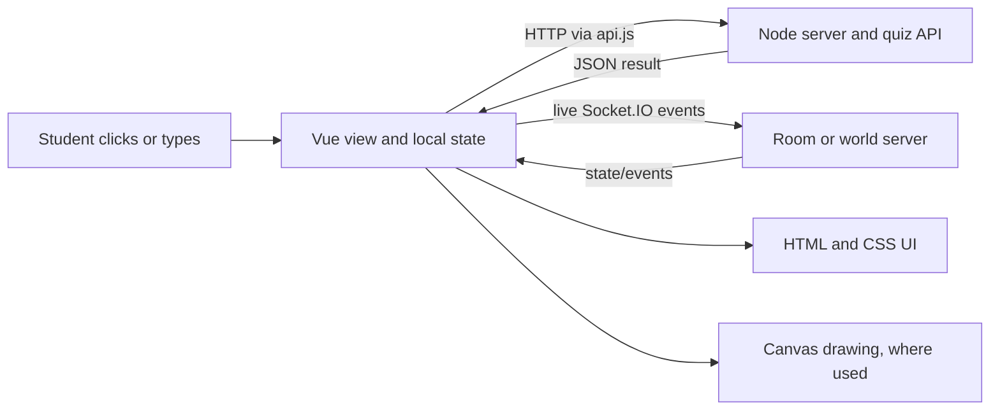

# 01 — Foundations

## 1. WHAT THE PLAYER SEES

QuizQuest opens as a sign-in page when no valid account is restored. A signed-in student sees a shared top bar and one student view; the Kingdom, World selector and Summon tabs use an immersive layout that can tuck the bar away. The shell is Vue; the town and a few ambient scenes are drawn into canvases.

## 2. HOW IT WORKS

### Browser parts, plain language

- **HTML / DOM:** HTML is the page's named building blocks (buttons, headings, panels). The browser keeps these as a tree called the DOM—like labeled paper cutouts that can each receive clicks and text. Vue components such as `KingdomView.vue` and `PetsView.vue` build most UI this way.
- **CSS:** CSS is the visual rulebook for those elements: colors, positions, responsive layout and transitions. Here it also runs many decorative animations; examples are `app.css`, `<style scoped>` blocks and `ScreenWipe.vue`'s styles.
- **JavaScript:** JavaScript handles decisions and events. Vue's `ref`/`reactive` values drive visible updates; event handlers send requests and start animations.
- **Canvas:** A canvas is a blank pixel surface that JavaScript paints directly, like a sheet of animation paper. It is good for a large scene with many moving pieces, but its individual drawn objects are not separate HTML buttons or text; accessibility and interaction have to be added separately. `KingdomTown.vue`, `LoginPreview.vue`, `WorldView.vue`, `SummonSky.vue`, `AvatarPreview.vue`, `HeroIcon.vue` and `CosmeticIcon.vue` use canvas.

The shell is `web/src/main.js` → `App.vue` → the current view component. `App.vue` defines student tabs as `kingdom`, `practice`, `progress`, `world` (component `HeroLabView`) and `pets` (component `PetsView`). The view key includes tab, session view key and token, so tab/user changes remount the component and its cleanup runs.

### Render loops, canvases and scaling

**requestAnimationFrame** (rAF) asks the browser to call a drawing callback before its next screen refresh—like asking for the next animation cel. A **render loop** is a callback that schedules itself again to keep drawing. A **delta time** is elapsed time between frames; it prevents movement from depending on how fast a computer draws. In the town, `KingdomTown.vue` computes elapsed time for movement/animation; `LoginPreview.vue` uses the callback timestamp; the separate class world repeatedly draws latest socket state in `WorldView.vue`. `SummonSky.vue` caps its loop at `SUMMON_SKY_FRAME_CAP_FPS = 30` and pauses it when hidden/offscreen. No single global loop exists.

The main game arena lives in `public/hero-lab/` in an iframe and owns its own drawing loop (`world.js:draw()` reschedules itself with rAF). Exact number of loops/surfaces at runtime is **not a fixed count**: the mounted page, hero icons and offscreen caches change it. `world.js` is the arena's loop; no `arena.js` entry was found in the inspected source.

**devicePixelRatio** is the ratio between physical screen pixels and CSS layout pixels—like printing a one-inch drawing with several dots per inch. `LoginPreview.vue` clamps it to 1–2; `SummonSky.vue` 1–2; `AvatarPreview.vue` and `CosmeticIcon.vue` 1–3; `HeroIcon.vue` uses `SPRITE_DPR_MIN` and the device ratio. The town has fixed world dimensions from `config/tuning.js`: `TOWN_WIDTH = 1280`, `TOWN_HEIGHT = 720`. On resize, `KingdomTown.vue:resize()` sets the canvas backing size to viewport size × DPR and calculates `scale = max(fit, readable) * dpr`, where fit matches the town dimensions and readable aims for at least a 520 CSS-pixel scene width. It does not add explicit black bars; when the visible world is smaller than the town, camera framing shows a moving crop and follows the player. This happens whenever the app viewport is narrow enough—including when its window is snapped to one side of the screen—not only in portrait orientation. `ResizeObserver` triggers this on frame-size changes. Camera framing changes between `town` and `north` at player y -14/+14 and eases with `1-exp(-dt*4.2)` (reduced motion uses 14).

### State, server and assets

`web/src/api.js` exports the reactive shared object `S` (account, token, tab and view/filter state). Reactive means Vue watches a value and refreshes the visible page when it changes—like a noticeboard that updates when its card is replaced. The token is stored per tab under `sessionStorage['qq-token']`; dashboard preferences use local storage. `restoreSession()` asks `GET /api/me`; sign-in posts `/api/login`; successful student sign-in chooses `kingdom`. `web/src/student/home.js:loadHome()` requests `GET /api/student/home` and keeps shared home data in `store.home`: `wallet.balance` is the coin balance, `inventory.heroes` is the owned-hero ID list, and `inventory.resources` holds wood/crystal/herb quantities. `KingdomView.vue` separately requests `GET /api/student/kingdom` when the student has a class; response `buildings` levels drive building art and bonuses. Avatar color is part of the session user (`S.me.avatarColor` / `avatarVisual`) and the wardrobe routes save it server-side (see `04-avatar-and-cosmetics.md`). Views update their state from server responses; `home.js:updateBalances()` applies balance/resource updates. The server decides grading and rewards; the client displays server answers.

**Asset loading and caching:** `avatar.js:loadPlayerVisuals()` fetches `/hero-lab/hero-visuals.json`, decodes images and crops frames into canvases; `tintedPlayerFrames()` caches by color. `HeroIcon.vue` shares loaded images and cached generated canvas frames; if an image cannot load or a hero has no visual, the component displays `hero.emoji`. In `KingdomTown.vue`, a wandering hero falls back to the hero emoji when its visual/frame is absent; the player avatar falls back to a small vector-drawn cat with eyes and ears while its frames are unavailable. `town-scene.js` draws static art once into offscreen canvases stored in `artCache`; the visible town canvas composites them. Sound loading/playback is in `web/src/sound.js` and `public/hero-lab/arena-audio.js`. The arena uses its own fallback icon/emoji handling in `public/hero-lab/world.js`.

## 3. WHERE IT LIVES

- `web/src/main.js`: app mount and bundled fonts/styles.
- `web/src/App.vue`: tab map, session gate, view mounting, global menus and wipe.
- `web/src/api.js`: `S`, `api`, `signIn`, `signUp`, `restoreSession`, `setTab` and HTTP token handling.
- `web/src/student/home.js`: shared `store.home`, `loadHome()` and `updateBalances()`; `web/src/student/KingdomView.vue`: Kingdom/profile data loading and overlays; `KingdomTown.vue`: town canvas and local player.
- `web/src/student/PracticeView.vue`, `QuizRunner.vue`: practice flow; `HeroLabView.vue`: World tab selector/room; `PetsView.vue`: Summon.
- `config/tuning.js`: town, summon, combat effect values; arena-specific tuning also lives in `public/hero-lab/game-config.js`.

## 4. DATA AND TIMING

HTTP is request/response; Axios calls resolve to JSON or throw. The arena and `WorldView.vue` receive event-driven socket messages, rather than polling the server on a fixed interval. The town starts its rAF loop after visual/map setup in `onMounted` and cancels it in `onUnmounted`; the login showcase similarly starts/stops around component lifetime; `WorldView.vue` starts drawing on mount and cancels/disconnects on unmount; `SummonSky.vue` starts when visible and stops when hidden/offscreen/unmounted. Summon sky targets 30 FPS; avatar preview uses a timeout at configured idle FPS (default fallback 5). CSS transitions/animations use their declared durations. There is no one app-wide frame-rate setting.

## 5. HOW TO CHANGE IT

1. To add a student tab, edit `TABS.student` in `web/src/App.vue` and say: “Add a student tab named X that mounts component Y, and update the inventory documentation.”
2. To change the town's logical size, edit `TOWN_WIDTH`/`TOWN_HEIGHT` in `config/tuning.js`: “Change the kingdom town's logical dimensions to X by Y and verify pointer coordinates still map correctly.”
3. To change Summon sky frame cap, edit `SUMMON_SKY_FRAME_CAP_FPS` in `config/tuning.js`: “Set the ambient Summon sky cap to X FPS; preserve visibility/reduced-motion pause behavior.”
4. To change session persistence, discuss `saved()`/`startSession()` in `web/src/api.js`: “Change only the student session persistence policy to X and keep stale-user responses ignored.”

## 6. GOTCHAS

- A canvas drawing is not automatically a button or readable text; the town canvas uses keyboard and pointer handlers, while the DOM overlays supply dialog controls.
- The World tab is the hero-lab page, despite the existence of a separate `WorldView.vue` class world.
- Remounting by key intentionally resets per-view state; state that must persist belongs in `S` or the server.
- This codebase has several independent animation clocks. Changing one FPS constant will not change all animation.
- API response field details should be checked against both the view and its handler before changing display logic.
