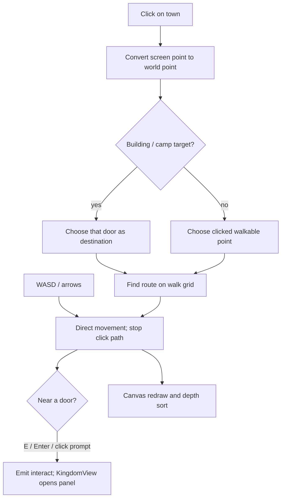

# 03 — Kingdom town

## 1. WHAT THE PLAYER SEES

The Kingdom is a walkable top-down town with a castle, upgrade buildings, roads, trees and a north trail to Duel and Campfire Run. The player moves with keys or clicks, can approach doors to interact, and sees owned heroes wander and greet them. Building panels, trade, avatar customization and tour UI sit above the scene as DOM dialogs.

## 2. HOW IT WORKS

**World coordinates** are positions on the full map; **screen coordinates** are pixels in the visible window. A **camera** is the movable viewing window over a larger drawing—like a camera operator panning across a stage. `KingdomTown.vue` has a `camera` object `{x,y,ready}` and zones named `town` and `north`; `updateCamera()` switches zone at player y -14/+14 and smoothly moves the camera toward a centered/clamped target using exponential easing (`1-exp(-dt*4.2)`, 14 under reduced motion). On wide screens it can show the whole town; when the viewport is too narrow to show the active zone, the camera follows the player. This includes a desktop window snapped to the side, not only a portrait phone. The fixed world dimensions are 1280×720, while the north clearing uses negative Y. Resize uses the viewport-sized canvas backing store and click coordinates are converted through scale, DPR and camera offset. This is a moving crop, not a fixed letterboxed world.

The ground and roads are built from constants in `config/tuning.js`; static houses, trees, rocks, flowers, paths and building art are drawn in `town-art.js` and `town-scene.js`. Art is placed in world coordinates; objects and moving characters are ordered by their ground `sortY` so lower/nearer things paint over farther things. This is 2D canvas, not CSS positioning of each tree. `artCache` keeps each level/prop drawing in an offscreen canvas. Ground and forest layers are also created for reuse.

**Collision** is a rule that stops characters passing through solid things, like invisible fences. `canStand()` checks walk zones and obstacles. Building footprints are rectangles; tree trunk/rock/sign obstacles use smaller shapes. A grid is built at `TOWN_TILE_SIZE=32`; `findPath()` uses breadth-first search over eight neighbor directions and prevents diagonal corner cutting. That grid route is used for click-to-move and hero wandering. Keyboard movement clears the current path. Door interaction uses `TOWN_DOOR_RADIUS=44`; greeting uses `TOWN_GREET_RADIUS=62`. The prompt itself is drawn on canvas and pointer hits are handled by `promptHit`.

Building level art: `buildTownObjects()` caches a drawing by `building:level`; level 0 shows a faint stage-one plan behind scaffolding, and levels 1–3 select the corresponding stage renderer in `town-art.js:drawBuildingStages()`. Building/castle renderers live in `kingdom/buildings/*.js`; `BUILDING_LEVEL_CAP=3`. Level changes recreate the object list and update the canvas. The DOM modal/panel content is in `KingdomView.vue`; upgrade actions call `upgrade()` and server API. Kingdom upgrade celebration is not town canvas confetti in the inspected code; `IsoKingdom.vue` animates SVG blocks dropping, while major game/Summon confetti uses separate systems. Any separate town upgrade confetti is **not implemented/found**.

Wandering heroes are capped at `TOWN_MAX_HEROES=10`. `initializeWanderers()` loads owned hero visuals, samples safe grass positions, then `chooseHeroDestination()` picks a reachable rest point within 420 pixels. They stay away from roads/plaza, doors and obstacles. `updateWanderers()` moves them at 72 px/s and eases nearby characters apart rather than treating them as hard blockers. Hopping follows an absolute sine curve at three hops/second, normally 10px high (3px in reduced-motion mode); the ground shadow stays on the floor. The student avatar uses its own smaller sine hop (4px, or 1.5px reduced motion) while moving.

## 3. WHERE IT LIVES

- Main interaction/rendering: `web/src/student/KingdomTown.vue`: `canStand`, `buildGrid`, `findPath`, `setDestination`, `interact`, `initializeWanderers`, `updateWanderers`, draw loop and resize setup.
- Town layout/config: `config/tuning.js`: `TOWN_WIDTH=1280`, `TOWN_HEIGHT=720`, `TOWN_TILE_SIZE=32`, `TOWN_WALK_SPEED=180`, hero speed 72, hop height 10 and 3 hops/sec, paths/zones/building placements.
- Static art/cache: `web/src/student/kingdom/town-scene.js` (`buildTownObjects`, `createGroundLayer`, `artFor`, `drawnTop`) and `town-art.js`.
- Upgrade stages: `web/src/student/kingdom/buildings/index.js` and `castle.js`, `garden.js`, `library.js`, `tower.js`, `workshop.js`.
- Panels and upgrade data: `KingdomView.vue`, `kingdom/panels/*.vue`, `config/tuning.js` (`BUILDING_BONUS_PER_LEVEL=0.1`, cap 3).

## 4. DATA AND TIMING

Kingdom view loads account/home data and passes `buildings`, `castleLevel`, `avatarColor`, avatar cosmetics and heroes as `KingdomTown` props. The map redraws via rAF while mounted; movement uses elapsed time. `props.paused` clears input during dialogs/intro. Click paths are recomputed per pointer click; there is no continuously recomputed path planner. Hero rests last 1–3 seconds normally; reduced motion rests 2.5–5 seconds. The tower and other building bonus values are server/game tuning, while the view visual level comes from loaded profile data.

## 5. HOW TO CHANGE IT

1. “Move the library entrance to X,Y by changing its layout/door in `kingdom/buildings/library.js`; update collision/road geometry in `config/tuning.js` if needed.”
2. “Make the student walk at X pixels/second by changing `TOWN_WALK_SPEED` in `config/tuning.js`; preserve delta-time movement and collision.”
3. “Increase hero hop height to X by changing `TOWN_HERO_HOP_HEIGHT`; preserve the reduced-motion override.”
4. “Add a new non-interactive prop by adding its layout and drawing function in `town-scene.js`/`town-art.js`, plus its collision shape if solid.”
5. “Change the road/path width through `TOWN_PATH_WIDTH` or `TOWN_TRAIL_WIDTH` and check `onRoad`, collision and drawing use the same geometry.”

## 6. GOTCHAS

- Map positions, drawing art and collision footprints are separate pieces of data; moving only one can make a visible door unreachable or a tree passable.
- The town is 1280×720 logical space and includes negative Y for the north clearing; do not assume every visible coordinate starts at zero.
- Hero visuals load asynchronously; failed sprite loading logs a warning and may leave fallback/no art while town behavior continues.
- The isometric SVG kingdom and the walkable canvas town are separate renderers; changing one does not automatically change the other.
- “Upgrade confetti” was not found as a KingdomTown effect; the confirmed celebration is the SVG block drop in `IsoKingdom.vue`.
