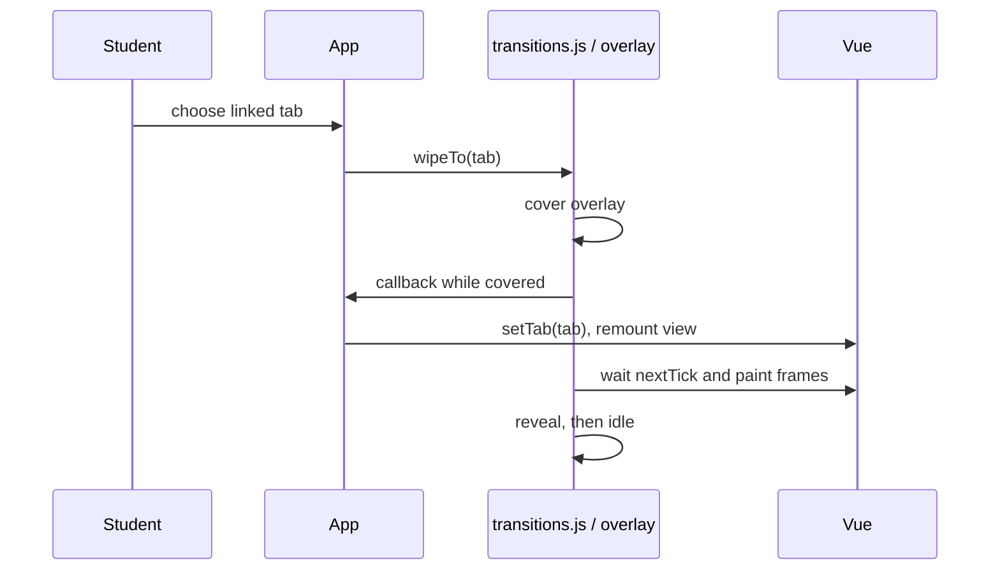

# 05 — Transitions and camera effects

## 1. WHAT THE PLAYER SEES

Moving between the Kingdom and Quiz, Campfire Run or Summon is covered by a storybook sheet that sweeps across. Summon entry from the telescope uses a closing/opening lens. Other tab switches happen immediately. Arena combat can shake and zoom the camera; those effects are separate from page navigation.

## 2. HOW IT WORKS

`App.vue:openStudentTab()` calls `wipeTo()` for Kingdom ↔ Quiz/Campfire Run/Summon transitions. The internal tab IDs remain `practice` and `world`. `transitions.js:wipe()` sets a reactive phase (`cover` → `covered` → `reveal` → `idle`). `ScreenWipe.vue` draws the overlay as regular DOM; CSS keyframes move the sheet or animate the iris. When covered, callback switches the tab; it waits for Vue's next update and two animation frames (with 120ms fallback) before revealing. The “shape” is either the green paper sheet with SVG mark and decorative edges, or a circular telescope iris with a dark navy field. It travels from left to right for the page sheet. Telescope is centered and expands/contracts. CSS owns the motion; JavaScript owns phase/timing and destination switch.

Current timing in `transitions.js`: page cover/reveal 260/260ms; telescope 460/520ms; reduced-motion fade 110/130ms; callback hold limit 3000ms; failsafe adds 800ms after phases. `prefersReducedMotion()` reads browser preference. Page wipe whoosh is skipped for reduced motion and telescope; telescope reveal uses `summonArrive`. `PracticeView.vue` has another local encounter wipe, implemented in that view's own DOM/CSS with an emblem; it is separate from the shared page wipe.

Other transitions: ordinary Vue modal visibility and controls use CSS transitions/keyframes in their component styles and `app.css`. The login camera pan is canvas camera math (see login document). Prize reveal uses DOM/CSS. Isometric block drops are SVG elements styled by CSS. No single shared transition engine drives all of these.

Arena shake: `config/tuning.js` defines a “trauma” model—trauma is a shake-strength meter that rises on events and decays over time, similar to a spring that gets pushed then settles. Constants include player-hit 0.2, ultimate 0.5, boss slam 0.45, max trauma 0.6, decay 1.8, max offset 36px, absolute cap 40px, noise frequency 25Hz. The code comment says offset is proportional to trauma squared, and a player intensity setting scales it (default 50%, range 0–200%). In `public/hero-lab/world.js`, the canvas draw applies camera shake and a timed `cameraZoom` for boss waves; `game-config.js` sets `bossZoom: 1.05`, `bossZoomMs: 300`. HUD stays outside the scene transform. Boss zoom starts on a `bossWave` event and is centered around the arena drawing; screen-space confetti is explicitly drawn after the camera transform is reset, so it does not zoom or shake.

## 3. WHERE IT LIVES

- `web/src/App.vue`: linked tabs and `openStudentTab()`.
- `web/src/transitions.js`: `TIMING`, `HOLD_LIMIT_MS`, `wipe`, `wipeTo`, `cancelWipe`, `prefersReducedMotion`.
- `web/src/components/ScreenWipe.vue`: overlay phase/variant DOM and CSS animations.
- `web/src/student/PracticeView.vue`: separate encounter wipe.
- `config/tuning.js`: `SHAKE_*` constants and player slider range.
- Arena camera/effect code: `public/hero-lab/world.js` (`cameraZoom`, draw transform); `public/hero-lab/game-config.js` (`ARENA_TUNING.waveMoments.bossZoom=1.05`, `bossZoomMs=300`).

## 4. DATA AND TIMING

The destination tab is changed only after cover completes. The overlay reports actual CSS `animationend`; a grace timer handles delays. Callback is bounded at 3 seconds and a failsafe always clears the overlay. Reduced motion converts the sweep to a plain opacity fade. Arena shake uses game events and decay, not the page transition state.

## 5. HOW TO CHANGE IT

1. “Make the regular page wipe take X ms in each direction by editing `TIMING.page` in `web/src/transitions.js`; preserve animation-end grace and failsafe.”
2. “Change the telescope close/open duration in `TIMING.telescope`; keep the centered iris and reduced-motion fallback.”
3. “Change shake strength by adjusting the relevant `SHAKE_*_TRAUMA` value in `config/tuning.js`; preserve trauma cap, intensity slider and reduced motion.”
4. “Change the boss camera zoom in `ARENA_TUNING.waveMoments` in `public/hero-lab/game-config.js`; preserve the 300ms pulse and keep HUD/confetti in screen space.”

## 6. GOTCHAS

- A new tab needs to be added to the Kingdom linked set if it should wipe; otherwise `setTab()` switches immediately.
- A callback that runs longer than 3 seconds may lose the cover and expose incomplete work; keep callbacks short.
- Wipe phases are shared globally; a second cover/covered wipe is ignored.
- Screen wipe is a CSS animation on a DOM overlay, not a canvas effect. Arena shake is on the game scene, not the page.
