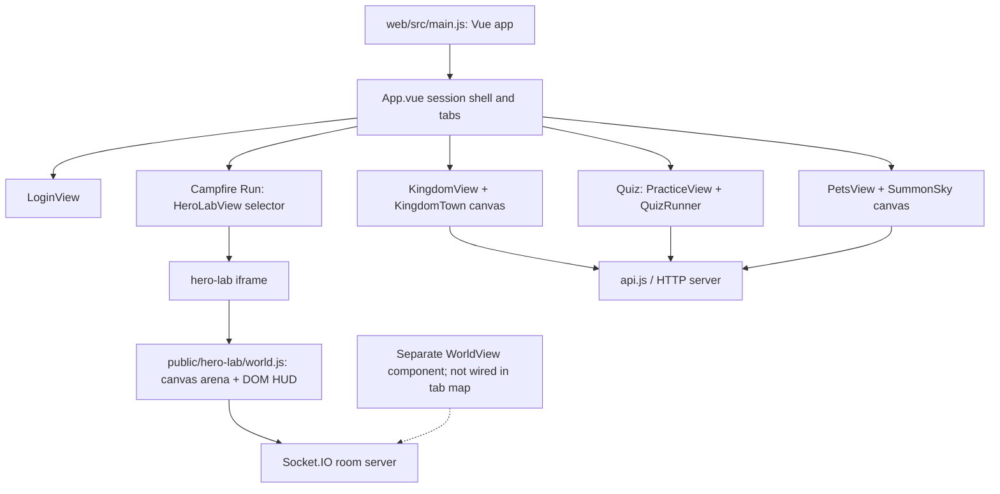

# 09 — Glossary and change guide

## Glossary

- **Animation frame / requestAnimationFrame (rAF):** A browser callback timed before a display refresh; repeated calls make a canvas animation. Like being handed the next frame in a flipbook.
- **API:** A named doorway for one program to ask another for data or an action. QuizQuest's browser calls server endpoints through `web/src/api.js`.
- **Axios:** The HTTP request library used by `web/src/api.js`; it sends browser requests and turns responses/errors into JavaScript results.
- **Bearer token:** A secret session string sent with a request to show the server which signed-in user is making it. Whoever holds it can act as that session, so the app keeps it in per-tab storage.
- **Breadth-first search:** A way to explore a map outward one step at a time until a destination is reached. The town uses it to find a route through walkable grid cells.
- **Cache:** A saved copy of work that can be reused. Cached town art or tinted sprite frames avoid drawing/recoloring the same image repeatedly.
- **Canvas:** A blank pixel surface JavaScript paints. It is a single picture, not a collection of individually accessible buttons.
- **Collision:** A rule that blocks movement into a solid object. Like invisible walls around a tree trunk.
- **Component:** A named, reusable piece of a Vue page, like a panel that can be assembled into different screens.
- **CSS:** Rules for how HTML looks and moves: color, layout, transitions and keyframe animation.
- **CSS transition:** A CSS rule that eases a property from its old value to a new value when it changes, such as a bar width.
- **CSS variable:** A named reusable value in CSS (often starting `--`), such as an animation duration passed from JavaScript.
- **Delta time:** Time elapsed since the prior animation update. Multiplying movement by it keeps motion similar on fast and slow computers.
- **Device pixel ratio (DPR):** Physical screen pixels per layout pixel; a high-density screen needs more painted pixels for a crisp result.
- **DOM:** The browser's tree of HTML elements. Think of labeled blocks that can be clicked, focused and read separately.
- **Easing:** A timing curve that makes motion begin/end slowly or accelerate. It changes the feel without changing the destination.
- **Event listener:** A function that waits for a click, key press, socket message or browser event, then responds.
- **Express:** A Node.js web-server framework used by the server entry to expose the app and API routes.
- **Frame rate (FPS):** Number of pictures drawn per second.
- **HTML:** The page's structural elements—buttons, text, forms and sections.
- **HTTP:** The usual request-and-response method a browser uses to ask a web server for information or an action.
- **Iframe:** A page embedded inside another page, like a window inside a window. The hero-lab game is embedded this way.
- **Isometric:** A way to draw a 3D-looking scene on a flat screen, using slanted edges so depth is suggested without perspective shrinking.
- **JSON:** A text format for sending structured values such as names, colors and lists between browser and server.
- **Keyframe animation:** A CSS animation defined by named points such as “start” and “end”; the browser fills in the motion between them.
- **Letterboxing:** Empty bars around a scene when it is fitted inside a window with a different shape. The Kingdom instead zooms/crops on narrow screens.
- **Modal:** A dialog that sits over a page and asks for attention before the player returns to the screen underneath.
- **Offscreen / screen-space drawing:** Offscreen drawing happens outside the visible canvas for reuse; screen-space drawing is fixed to the view and does not follow the world camera.
- **Offscreen canvas:** A canvas kept out of view to prepare art for later reuse. It is like making a reusable sticker before placing it on the scene.
- **Particle:** A small visual piece that moves or fades briefly, such as a spark, confetti square or smoke puff.
- **Pathfinding:** Choosing a sequence of walkable steps to reach a destination; the Kingdom uses a grid search for click-to-move.
- **Pooling:** Reusing expired effect objects instead of making new ones repeatedly. Arena particle objects return to `particlePool`.
- **Reduced motion:** An accessibility preference asking the page to limit movement; components here read the browser's `prefers-reduced-motion` setting.
- **Remount:** Removing a screen component and creating it again, which resets its temporary state and runs its cleanup steps.
- **Render loop:** A repeated callback that redraws a scene while it is active.
- **Responsive layout:** A layout that changes arrangement or size to fit different screen widths.
- **Route:** A named web address or app destination. Student screens in this app are primarily tabs, not separate student URLs.
- **Session storage / local storage:** Browser memory for saved text values. Session storage ends with a tab session; local storage usually remains after closing/reopening the browser.
- **Socket.IO:** A live two-way connection for events between browser and server, used by rooms/game worlds.
- **Sprite:** A picture or frame used to draw a character. Several frames can create a blink or walk cycle.
- **State:** The current values the app remembers, such as selected tab, loaded heroes or modal-open status.
- **SVG:** A drawing format made from shapes and paths rather than a grid of pixels. QuizQuest uses it for icons and some scene/character artwork.
- **Trauma:** In this game, a number that measures how strongly the camera should shake; events add it and time drains it away.
- **Tween:** A value changing between endpoints over time. A dimmer turning gradually from low to high is a tween.
- **Vue:** The JavaScript interface framework used to assemble screens from components and refresh displayed values when state changes.
- **World coordinates:** Positions on the whole scene/map, even outside the visible portion.

## Where do I change X?

| Request | File and value/function | Ready-to-paste instruction |
|---|---|---|
| Change the town/avatar default color | `config/tuning.js`: `TOWN_AVATAR_DEFAULT_COLOR`, `TOWN_AVATAR_PRESET_COLORS` | “Change the default/preset avatar colors in `config/tuning.js`, keep server color validation aligned.” |
| Speed up/slow down the screen wipe | `web/src/transitions.js`: `TIMING.page` / `TIMING.telescope` | “Set page wipe cover and reveal to X ms; keep switch-under-cover and failsafe logic.” |
| Change town hero hop height | `config/tuning.js`: `TOWN_HERO_HOP_HEIGHT` | “Set town hero hop height to X pixels and preserve reduced-motion override.” |
| Change boss confetti count | `config/tuning.js`: `CONFETTI_COUNT` | “Set arena boss confetti count to X; preserve quality scaling and screen-space rendering.” |
| Add a town building | `config/tuning.js` layout/roads + `kingdom/buildings/*.js` + `town-scene.js` + `KingdomView.vue` panels | “Add building X through layout, door/collision, renderer/stages, panel data and upgrade API; list each changed source.” |
| Add a cosmetic | `config/avatar-cosmetics-data.json`, `config/avatar-cosmetics.js`, `kingdom/avatar-cosmetics.js`, `KingdomView.vue`, server avatar API | “Add cosmetic X across catalog, ownership/equip validation, canvas overlay drawing and wardrobe preview.” |
| Change camera zoom in arena | `public/hero-lab/game-config.js`: `ARENA_TUNING.waveMoments.bossZoom`, `bossZoomMs` | “Change boss zoom scale/duration through `ARENA_TUNING.waveMoments`; keep HUD and screen-space confetti unaffected.” |
| Change town movement speed | `config/tuning.js`: `TOWN_WALK_SPEED` | “Set town player speed to X px/s and preserve delta-time collision/path movement.” |
| Change Summon stars/meteors | `config/tuning.js`: `SUMMON_STAR_COUNT`, `SUMMON_METEOR_INTERVAL_*` | “Adjust Summon sky stars/meteor frequency; keep 30 FPS cap and visibility/reduced-motion handling.” |
| Change ability cooldown/ready glow | `config/tuning.js`: `COOLDOWN_RING_TRANSITION_MS`, `READY_GLOW_PERIOD_MS`; arena `game-config.js` | “Change arena ready glow/cooldown ring timing and keep the HUD CSS variables connected to config.” |

## Student-side architecture

## Ten risks / technical debt observations

Ranked by how broadly a change can surprise the student experience:

1. **Two different “World” implementations:** Campfire Run tab points at `HeroLabView`, while `WorldView.vue` is another student world with its own socket protocol and no shell entry found.
2. **Several independent avatar drawing paths:** town, avatar preview, class world and arena can drift in color/cosmetic support.
3. **Animation policy is distributed:** reduced motion, frame caps and timing live in multiple Vue components, CSS and arena config.
4. **Layout, collision and art are separate town data:** modifying just one can create invisible walls or inaccessible doors.
5. **Tuning duplication/bridges:** `config/tuning.js` and `public/hero-lab/game-config.js` both expose arena-related values; verify imports and mappings before edits.
6. **A canvas isn't semantic UI:** custom-drawn town text/objects need parallel labels and keyboard paths for accessibility.
7. **Mount/remount controls cleanup:** app shell deliberately remounts views; timers, observers, sockets and listeners must all be cleaned up.
8. **Cached visual variants consume memory:** tinted avatar frames, hero frames and town-art offscreen layers are retained in maps; catalog growth can increase memory use.
9. **Server and browser are separate authorities:** changing only client display/effects does not change validated rewards, inventory or account values.
10. **Hidden debug paths are in student components:** version taps, local storage flags and preview modes can be mistaken for supported player features if not labeled.

## Anything confusing or not verified

- The student-facing shell labels `HeroLabView` as Campfire Run; separate `WorldView.vue` is not mapped to a tab and its product entry point is unknown.
- Arena boss zoom is confirmed: scale 1.05 for 300ms; it affects the arena scene transform, not HUD/screen-space celebration.
- No Kingdom-specific confetti upgrade effect was found; the confirmed town build celebration is the isometric SVG block drop.
- No single global canvas count or render loop exists, so those counts depend on which views and subcomponents are mounted.
- A complete list of every CSS easing curve across the large global stylesheet is not maintained here; use the exact source style for each effect.

