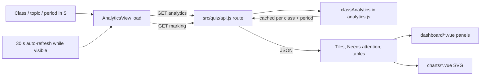

# 10 — Teacher Analytics dashboard

This page covers the professor-facing **Analytics** tab, which the code and other screens call "the Analytics dashboard". It is the only teacher screen documented in this guide. The student page **My Progress** (`ProgressView.vue`) is a different, much simpler page; see [00-inventory.md](00-inventory.md).

## 1. WHAT THE PROFESSOR SEES

When a teacher signs in, the first tab is **Analytics**. At the top is a toolbar with a class picker, a weekly-topic picker, a period picker (Last 7 days, Last 30 days, This semester, All time, Custom dates), an auto-refresh switch and a **Print report** button. Below the toolbar a section bar jumps to each part of the page and highlights the part currently on screen:

| Section | What it shows |
|---|---|
| **Overview** | Number tiles (students who practised, active in the last 7 days, sessions completed, answers submitted, and answers still awaiting marking if there are any). Each tile can show how it changed against the previous period and a small trend line. Next to the tiles: a "First-attempt accuracy by topic" bar list, weakest first, and a **Needs attention** list of things worth acting on. |
| **Weekly topics** | One row for every weekly topic in the course: lecture files, knowledge report, draft and published questions, how the class is doing, and one suggested next step (for example "Review 3 drafts" or "Add lecture files"). |
| **Trends** | Accuracy per topic over time (line chart), answers per day or week (column chart), a "When students practise" heat grid (weekday × 3-hour block) and, only when there are World answers, a Practice vs World accuracy comparison. Each chart has a "Show the chart data as a table" toggle. |
| **Topics and questions** | A "By topic" table that expands into learning outcomes (each with a **Draft** button), and a "Time and accuracy per question" table with group cards such as *Worth rereading* and *Quick but often wrong*. |
| **Commonly missed** | Questions most students get wrong on the first try, with the most chosen wrong answer. |
| **Question quality** | Questions missing tags, difficulty tags that don't match results, and wrong options almost nobody picks. |
| **Compare classes** | Only when the professor teaches two or more classes of the same course: those classes side by side, per topic. |

Clicking a question opens a detail dialog (`QuestionInsight.vue`). Several tables have a **Download CSV** button. **Nothing on this page names individual students.** Every figure is for the whole class.

## 2. HOW IT WORKS

### One filter row scopes everything

The class, weekly topic and period live in the shared reactive object `S` in `web/src/api.js` (`S.classId`, `S.topicId`, `S.range`, `S.from`, `S.to`). `dashQuery()` turns them into a query string such as `range=30d&topic=...`. Because `S.topicId` is shared, moving between Analytics, AI drafting and the Question bank keeps the same week selected.

`AnalyticsView.vue:load()` makes two requests in parallel:

- `GET /api/teacher/classes/:classId/analytics?<dashQuery>`: every number on the page, built by `classAnalytics()` in `src/quiz/analytics.js`.
- `GET /api/teacher/classes/:classId/marking`: how many answers wait for a mark (used by Needs attention).

`ComparePanel.vue` loads `GET /api/teacher/courses/:cid/compare` on its own, and `QuestionInsight.vue` loads `GET /api/teacher/classes/:classId/questions/:qid/insights` when a question is opened. The server caches each result per class and period and recalculates it only when that class's data changes (`cached(...)` with `versionOfClass` in `src/quiz/api.js`).

A request counter (`seq`) makes sure an older, slower response never replaces a newer one. While a new period loads, the old numbers stay on screen (dimmed), so the layout does not jump.

### Choosing a period

Presets load at once. **Custom dates** wait for **Apply**; `customPeriodError()` in `api.js` checks the dates with the same rules as the server's `parsePeriod` (valid dates, start before end, at most 366 days). **This semester** needs the course's semester start date from **Settings**. Without it, the dashboard falls back to the last 30 days and shows a note that links to Settings. A period is remembered only after it loads successfully, so a period the server refuses does not come back on the next visit.

Days and weeks are counted in the **class time zone** (default Singapore), set in **Classes & Roster**. An answer at 7am on Tuesday counts on Tuesday, not on the day it is in UTC.

### Auto-refresh

A 5-second interval checks whether a refresh is due. It reloads quietly when auto-refresh is on, the browser tab is visible and 30 seconds (`REFRESH_MS`) have passed since the **last attempt**. Counting from the last attempt means a server that is down is not asked every 5 seconds. A quiet refresh:

- does not dim the page or replay the chart draw-in animation;
- makes any tile whose number changed glow briefly (`notice()` → `pulse`);
- on failure, shows that the numbers are stale instead of silently keeping old numbers.

### How the numbers are counted (server side)

From the header of `src/quiz/analytics.js`:

- Every percentage comes with its count, for example `62% (31/50)`.
- **First attempts are kept separate from retries**, because a retry right after seeing the explanation says less about understanding.
- Short answers waiting for the professor's mark are **left out of every accuracy figure** and counted separately as "awaiting marking".
- Low accuracy is a prompt to investigate (a hard concept, an unclear question or a teaching gap), never an automatic grade or label.

Thresholds used on the page:

| Constant (`analytics.js`) | Value | Meaning |
|---|---|---|
| `MIN_N` | 3 | First attempts before a question can be "commonly missed"; topics with fewer are striped "few answers" in the Overview bars |
| `LOW_N` | 5 | Trend points and per-question figures from fewer answers are drawn hollow or flagged |
| `MAX_WEEKS` | 12 | "All time" charts show at most the last 12 weeks (tiles and tables still cover everything) |
| `DAILY_BUCKETS_UP_TO` | 14 | Periods up to 14 days chart per day; longer periods chart per Monday-start week |
| `CONFUSING` | slowest 25%, under 60% correct | "Worth rereading": slow **and** often wrong |
| `DIFFICULTY_CHECK` | ≥5 answers; easy <50%, hard >85% | A difficulty tag that doesn't match results |
| `UNUSED` | ≥20 answers, picked by <5% | A wrong option that isn't working as a distractor |
| `BLOCK_HOURS` | 3 | "When students practise" grid: 8 blocks of 3 hours per weekday |

### Overview tiles and comparisons

`tiles` in `AnalyticsView.vue` builds the tiles from `analytics.participation`. `delta()` compares against the previous period of the same length (for example "▲ 6 more than the 30 days before"). If the period includes today, the earlier period is counted only up to the same time of day, so an unfinished today is never compared with a whole day. The ⓘ button next to a comparison explains this. The small trend lines are `Sparkline.vue`; an unfinished last day or week is drawn hollow, so a dip there is not read as a drop.

### Needs attention

`attention` (a computed list in `AnalyticsView.vue`) adds an item only when it applies, and each item links to where you can act on it:

- answers waiting for a mark → **To review** tab
- drafted questions waiting for review → **Question bank**, Drafts filter
- questions missing tags, difficulty tags not matching results → Question quality
- open student reports → **To review** tab
- questions worth rereading (slow and often wrong) → opens the question if only one, otherwise the time table filtered to that group
- questions under 25% correct on first attempts (`VERY_LOW`) → Commonly missed
- this class at least 20 points behind another of your classes on a topic (`GAP`) → Compare classes
- weakest topic, if under 70% on first attempts → By topic
- learning outcomes with no published questions → By topic, with those topics expanded
- students who haven't practised in the last 7 days (count only, no names)
- uploaded files not yet placed in a weekly topic → AI drafting

### Question groups (time vs accuracy)

`web/src/teacher/charts/time-zones.mjs` places each question in one plainly named group, using the server's "slow" line (`slowMs`, the slowest quarter) and its 60% accuracy line: *Worth rereading*, *Quick but often wrong*, *Slow but mostly right*, *Quick and mostly right*, and *Not enough answers*. Each group carries a hint (what it likely means) and an action (what to do). Clicking a group card filters the table. With too few questions to know what counts as slow, questions are only split into mostly right / often wrong.

### Charts

The charts are hand-built Vue SVG components in `web/src/teacher/charts/`, not a chart library:

- `LineChart.vue`: one line per topic, 0–100%. Colour follows the topic's position in the course, never its rank, using up to 8 colour slots. With more than four topics (`MAX_COMBINED`) the page shows one small chart per topic on the same scale instead.
- `ColumnChart.vue`: answers per day or week. A day or week only partly inside the period is drawn lighter and labelled.
- `WhenPanel.vue`: a single-hue heat grid with a legend.
- `useWidth.js` measures the real width so text stays readable on phones instead of shrinking with a scaled image.

Accessibility: each chart is **one tab stop**. Arrow keys (and Home/End) move between points (`keys.js`), a live region announces the point, and every chart has a table view for screen readers.

### Exports and printing

`downloadCsv()` in `web/src/teacher/csv.js` builds CSVs in the browser from the data already loaded, with no extra server call. The three exports are Topic results, Question times and accuracy, and Commonly missed questions. File names describe their contents, for example `Commonly missed questions - <class> - <topic> - last 30 days to 23 Oct 2026.csv`. CSV exports never include student names. **Print report** calls `window.print()`. Print CSS in `web/src/app.css` hides the toolbar, dialogs and chart tables, shows a `.print-only` heading (class, topic, period, time zone, time generated) and expands every topic's learning outcomes.

### Layout

The toolbar sticks below the top bar. A scroll listener (`spy()`) marks the current section, and on phones the section bar scrolls sideways to keep the current button visible. When the full section labels don't fit, the bar switches to short labels (`compact` class). This is measured with a `ResizeObserver`, not set by a fixed breakpoint, because buttons come and go and the sidebar can be collapsed. Responsive rules are in `web/src/teacher/teacher-responsive.css`.

## 3. WHERE IT LIVES

- `web/src/teacher/AnalyticsView.vue`: page, filters, loading, auto-refresh, tiles, Needs attention, By topic, time groups, Commonly missed, CSV and print.
- `web/src/teacher/dashboard/`: `TopicsOverview.vue` (Weekly topics), `WhenPanel.vue`, `ContextsPanel.vue` (Practice vs World), `QualityPanel.vue`, `ComparePanel.vue`, `ReportsPanel.vue` (used on the **To review** tab, not on Analytics).
- `web/src/teacher/charts/`: `LineChart.vue`, `ColumnChart.vue`, `Sparkline.vue`, `keys.js`, `useWidth.js`, `time-zones.mjs`.
- `web/src/teacher/QuestionInsight.vue`: the question detail dialog.
- `web/src/teacher/csv.js`: CSV building and download.
- `web/src/api.js`: `S`, `dashQuery()`, `periodQuery()`, `dashPrefs()` / `saveDashPrefs()`, `customPeriodError()`.
- `src/quiz/analytics.js`: `classAnalytics()`, `courseComparison()`, `questionInsights()`, `parsePeriod()` and all thresholds.
- `src/quiz/api.js`: the `/api/teacher/classes/:classId/analytics`, `/marking`, `/questions/:qid/insights` and `/api/teacher/courses/:cid/compare` routes.
- Related settings: semester dates in `SettingsView.vue`; class time zone in `ClassManagementView.vue`.

## 4. DATA AND TIMING

- **Requests:** HTTP only, no Socket.IO. The analytics and marking requests on each load, plus the compare request (reloaded whenever the page reloads, via `stamp`) and the insight request when a question is opened.
- **Auto-refresh:** checked every 5 s; fires at most every 30 s from the last attempt; only while the tab is visible and the switch is on.
- **Remembered in this browser:** `localStorage['qq-dashboard']` keeps the period, the auto-refresh choice and the last class viewed. If storage is blocked, defaults apply (last 30 days, auto-refresh on). This is a convenience only; nothing important depends on it.
- **Animations:** charts draw in when a period loads (`drawKey` remounts them) but not on background refreshes. Changed tiles glow briefly. A section-bar jump outlines its target for 1.6 s.
- **Paging:** long lists show 5 rows per page (10 for the time table). Charts and CSV exports always use the full list.

## 5. HOW TO CHANGE IT

1. To change the refresh interval, edit `REFRESH_MS` in `AnalyticsView.vue`: "Change the Analytics auto-refresh to X seconds; keep the visible-tab check and the count-from-last-attempt back-off."
2. To change what counts as 'worth rereading', edit `CONFUSING` in `src/quiz/analytics.js`: "Change the possibly-confusing threshold to the slowest X% and under Y% correct; keep `time-zones.mjs` labels in step with the server."
3. To add a Needs attention item, edit the `attention` computed in `AnalyticsView.vue`: "Add a Needs attention item for X that links to section Y; keep it class-level with no student names."
4. To add a period preset, edit `PERIODS` in `AnalyticsView.vue`, `RANGES` in `src/quiz/analytics.js` and `savedPeriod()` in `api.js`: "Add a 'Last 14 days' period to the Analytics dashboard on both client and server, including remembered-preference validation."
5. To add a CSV column, edit the matching `topicsCsv` / `timeCsv` / `missedCsv` function: "Add column X to the Analytics CSV export; never include student names."

## 6. GOTCHAS

- **No student names, anywhere.** This is a deliberate design rule (see the headers of `AnalyticsView.vue` and `analytics.js`) and fits PDPA expectations. Any new tile, list, export or tooltip must stay class-level.
- Accuracy excludes answers awaiting marking. Don't "fix" a mismatch between answer counts and accuracy counts by including them.
- First-attempt and retry figures are separate on purpose. Merging them overstates understanding.
- The **When students practise** grid and the trend buckets use the class time zone, not the browser's. Test with a class in another time zone after changing date logic.
- `ReportsPanel.vue` sits in `dashboard/` but is shown on the **To review** tab. Analytics only links to it.
- "World" in **Practice vs World** (`ContextsPanel.vue`) and the "(N in World)" tile note means answers recorded with `context: 'world'` by the separate class world server (`src/world/world.js`, the back end of `WorldView.vue`; see [08-world-lobby-summon.md](08-world-lobby-summon.md)). It is **not** the Campfire Run arena, which does not record quiz answers. The panel is hidden when there are no World answers (`v-if="a.contexts.world.n"`), and because no shell tab opens `WorldView.vue` it will usually stay hidden.
- The chart colour for a topic follows its course order. Sorting or filtering must not reassign colours, or the same topic changes colour between charts.
- The client-side period checks in `api.js` mirror the server's `parsePeriod`. Change both together.
